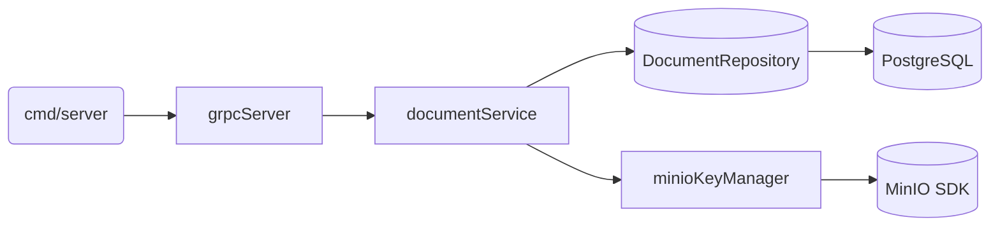

# Code / Module View

Основные пакеты:
- `internal/service/document` — бизнес-логика, валидация статусов.
- `internal/repository` — работа с PostgreSQL через `database/sql`.
- `internal/storage` — генерация ключей MinIO и проверки бакетов.
- `internal/transport/grpc` — серверная обёртка над gRPC методами.
