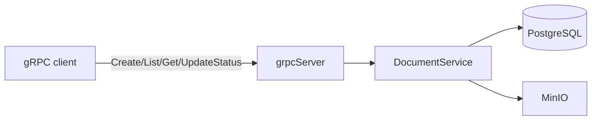

# Инфраструктурная схема

- PostgreSQL хранит таблицы `documents`, `document_versions`, `document_status_logs`.
- MinIO используется только для генерации ключей/папок; загрузка файлов производится внешними сервисами.
- Корреляционный идентификатор передаётся через метаданные gRPC `x-correlation-id` и пишется в логах сервера.
