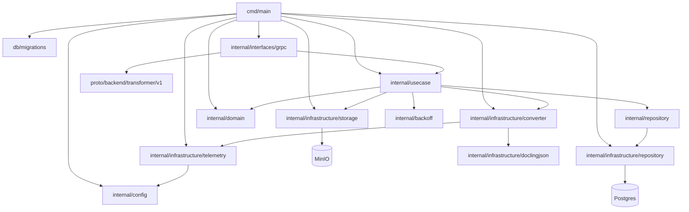

# Code / Module view

- `cmd/main` загружает конфигурацию (включая блок `docling_render`), инициализирует логгер и OTEL‑провайдеры, прогоняет миграции, создаёт клиентов MinIO и Postgres‑пула, восстанавливает подвисшие задачи, собирает Docling‑конвертер, поднимает воркер-процессор очереди и gRPC сервер.
- `internal/config` читает YAML‑конфигурацию сервиса с блоками Service, Scheduler, Docling (включая storage и статусный backoff), DoclingRender, MinIO, Postgres и Observability, применяет значения по умолчанию и валидирует параметры.
- `internal/interfaces/grpc` поднимает gRPC сервер `TransformerService` из proto, валидирует вход и correlation-id, проксирует вызовы юзкейса `TransformerUseCase` (очередь `ConvertDocumentToMarkdown` с optional `wait_for_result` и синхронный `ConvertDocxToMarkdown`).
- `internal/usecase` реализует доменный слой: `TransformerService` ставит задачи в очередь, переиспользует актуальные задания, рассчитывает ключи/бакеты/расширения и backoff статусов; `Processor`/`ConversionExecutor`/`DoclingPoller` управляют обработкой очереди, поллят Docling, загружают готовый Markdown в хранилище, пишут метрики и ведут ретраи/реанимацию.
- `internal/repository` описывает интерфейс `QueueRepository` для работы с очередью Docling‑трансформаций и операциями по восстановлению/очистке.
- `internal/infrastructure/repository` реализует `QueueRepository` для Postgres (`transformations_queue`): постановка и выбор задач, обновление статусов Docling, восстановление зависших, requeue/poll расписание и очистку завершённых.
- `internal/infrastructure/storage` оборачивает MinIO‑клиент для скачивания исходного файла и загрузки результата конвертации в нужный бакет/ключ.
- `internal/infrastructure/converter` реализует HTTP‑клиент Docling: submit задач (upload_file/source_async) с ретраями и заголовками correlation/API key, поллинг статуса/результата, выбор медиа-типов, построение multipart, поддержка MinIO‑стоража Docling и опциональный рендер Markdown из Docling JSON/таблиц.
- `internal/infrastructure/doclingjson` парсит JSON Docling и собирает Markdown по таблицам/marks.
- `internal/domain` содержит статусы, сущности очереди и утилиты: определение контент‑тайпов, нормализация расширений и построение ключей для Markdown.
- `internal/infrastructure/telemetry` предоставляет генерацию correlation-id, настройку OTEL провайдеров и вспомогательные опции для gRPC telemetry handler и логгера.
- `db/migrations` содержит миграции Postgres для таблицы `transformations_queue` и связанных индексов/колонок.
