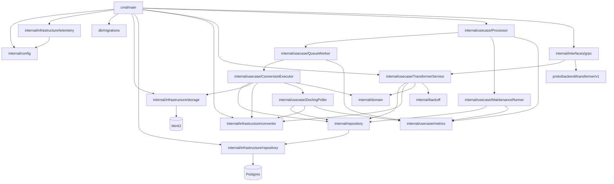

# Code / Module view

- `cmd/main` загружает конфигурацию (включая блок `docling_render`), инициализирует логгер и OTEL‑провайдеры, прогоняет миграции, создаёт клиентов MinIO и Postgres‑пула, восстанавливает подвисшие задачи, собирает Docling‑конвертер, поднимает воркер‑процессор очереди и gRPC сервер.
- `internal/config` читает YAML‑конфигурацию сервиса с блоками Service, Scheduler, Docling (включая storage и статусный backoff), DoclingRender, MinIO, Postgres и Observability, пробрасывает MinIO‑конфиг в Docling storage по умолчанию, проставляет дефолты backoff/PreferJSON и валидирует параметры и режим `source_async`.
- `internal/interfaces/grpc` поднимает gRPC сервер `TransformerService` из proto, валидирует вход и correlation-id, проксирует вызовы юзкейса: постановка задачи `ConvertDocumentToMarkdown` с опциональным `wait_for_result` и синхронный `ConvertDocxToMarkdown` (docx_content или docx_url с загрузкой по HTTP).
- `internal/usecase/TransformerService` ставит задачи в очередь, переиспользует актуальные задания, рассчитывает ключи/бакеты/расширения и backoff статусов для ожидания результата; синхронная конвертация отправляет файл в Docling и поллит до готовности.
- `internal/usecase/Processor` оркестрирует очередь: `QueueWorker` конкурентно берёт задачи, запускает `ConversionExecutor` и пишет метрики; `MaintenanceRunner` считает размеры очереди, восстанавливает/помечает зависшие задачи, ретраит failed по задержке и чистит завершённые.
- `internal/usecase/ConversionExecutor` собирает параметры конвертации (включая `source_async`, подстановку target/source бакетов и SubmitLock), скачивает источник (MinIO или URL), отправляет задачу в Docling или поллит её, загружает Markdown и фиксирует результат; `DoclingPoller` управляет backoff поллинга, повторно ставит задачи при ошибках/лимитах и сохраняет прогресс в БД.
- `internal/usecase/metrics` агрегирует метрики очереди, поллинга, времени выполнения и восстановлений; `internal/backoff` задаёт стратегию ожидания статусов и конвертаций.
- `internal/repository` описывает интерфейс `QueueRepository` для работы с очередью Docling‑трансформаций и вспомогательными операциями восстановления/очистки/лимитов.
- `internal/infrastructure/repository` реализует `QueueRepository` для Postgres (`transformations_queue`): сериализованный выбор задач (приоритет `waiting_docling`), advisory‑lock submit, хранение прогресса Docling, восстановление зависших/тайм‑аутных, requeue, ретраи failed по лимиту и очистку завершённых.
- `internal/infrastructure/storage` оборачивает MinIO‑клиент для скачивания исходного файла и загрузки результата конвертации в нужный бакет/ключ.
- `internal/infrastructure/converter` реализует HTTP‑клиент Docling: submit задач (upload_file/source_async) с ретраями и заголовками correlation/API key, поллинг статуса/результата, выбор медиа-типов, построение multipart и поддержку MinIO‑стоража Docling для source/target.
- `internal/domain` содержит статусы, сущности очереди и утилиты: определение контент‑тайпов, нормализация расширений и построение ключей для Markdown.
- `internal/infrastructure/telemetry` предоставляет генерацию correlation-id, настройку OTEL провайдеров и вспомогательные опции для gRPC telemetry handler и логгера.
- `db/migrations` содержит миграции Postgres для таблицы `transformations_queue` и связанных индексов/колонок.
