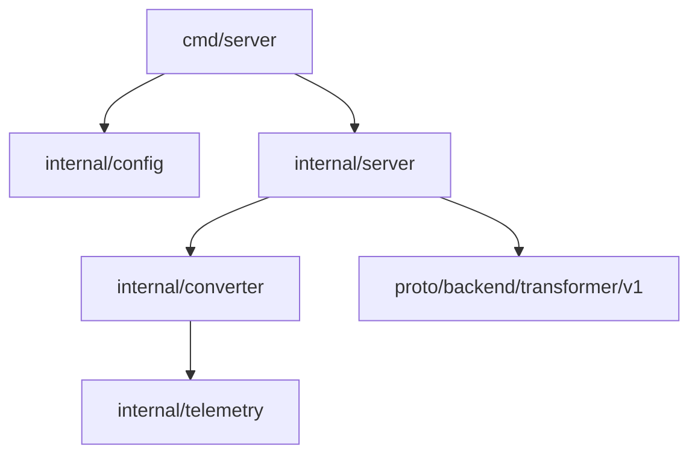

# Code / Module view

- `internal/server` содержит gRPC сервер и интерсептор логирования correlation-id.
- `internal/converter` знает только о HTTP Docling и не зависит от gRPC.
- `internal/telemetry` централизует работу с correlation-id.
