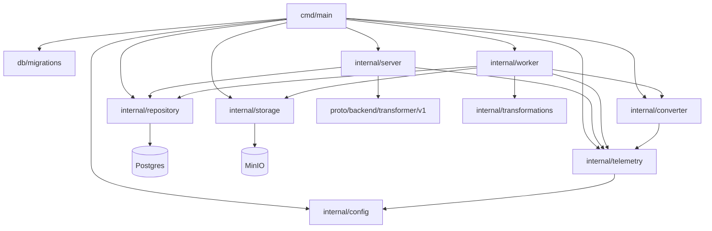

# Code / Module view

- `cmd/main` загружает конфигурацию, инициализирует логгер и OTEL‑провайдеры, прогоняет миграции, поднимает клиентов MinIO и Postgres, собирает конвертер Docling и очередь, запускает фоновые воркеры и gRPC сервер.
- `internal/config` читает YAML‑конфигурацию сервиса с блоками Service, Scheduler, Docling, MinIO, Postgres и Observability.
- `internal/server` поднимает gRPC сервер и регистрирует `TransformerService`, валидирует вход, подставляет значения по умолчанию для bucket/ключей и ставит задачи в очередь через репозиторий, добавляя interceptor логирования correlation-id и OTEL‑интеграцию.
- `internal/repository` реализует Postgres‑очередь трансформаций: постановка задач, выбор следующей, обновление статусов Docling, восстановление зависших, уборка завершённых и сбор статистики.
- `internal/worker` управляет пулом воркеров: забирает задачи из очереди, скачивает исходники из MinIO, отправляет их в Docling, поллит статус с экспоненциальной задержкой и ограничением попыток, загружает Markdown обратно в MinIO, пишет метрики и восстанавливает зависшие задачи.
- `internal/storage` оборачивает клиент MinIO для скачивания исходного файла и загрузки результата конвертации в указанный бакет.
- `internal/converter` реализует HTTP‑клиент Docling: отправка файла с заголовками correlation-id, API‑ключом и именем источника, повторные попытки отправки, нормализация статусов и поллинг результата.
- `internal/transformations` содержит утилиты для нормализации расширений и построения ключа Markdown.
- `internal/telemetry` предоставляет генерацию correlation-id, настройку OTEL провайдеров и вспомогательные опции для gRPC telemetry handler и логгера.
- `db/migrations` содержит миграции Postgres для таблицы очереди трансформаций и выполняется на старте сервиса.
