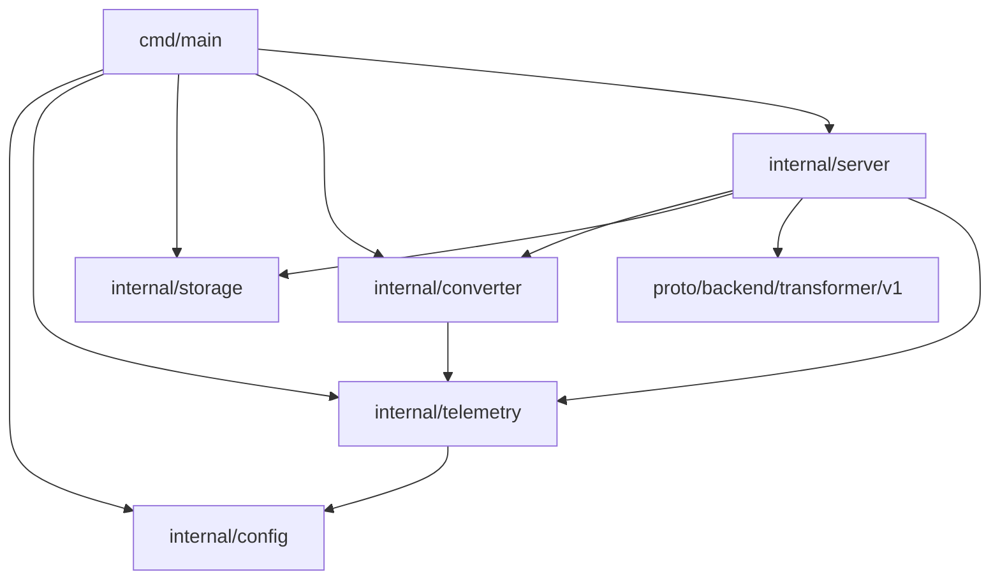

# Code / Module view

- `cmd/main` инициализирует конфигурацию, логирование и OTEL‑провайдеры, собирает зависимости (конвертер Docling и клиент MinIO) и запускает gRPC сервер.
- `internal/config` читает YAML‑конфигурацию сервиса и включает блоки Docling, MinIO, Temporal и Observability.
- `internal/server` поднимает gRPC сервер, регистрирует `TransformerService` и связывает его с конвертером и хранилищем Markdown, добавляя interceptor логирования correlation-id и OTEL‑интеграцию.
- `internal/converter` реализует HTTP‑клиент Docling, выполняет до трёх попыток конвертации DOCX → Markdown и прокидывает correlation-id в заголовках запроса.
- `internal/storage` оборачивает клиент MinIO для скачивания исходного файла и загрузки результата конвертации в указанный бакет.
- `internal/telemetry` предоставляет генерацию correlation-id, настройку OTEL провайдеров и вспомогательные опции для gRPC telemetry handler.
