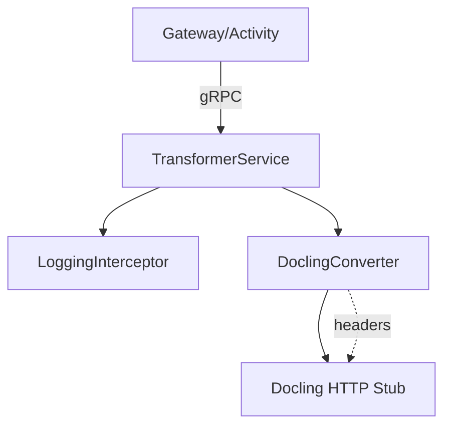

# Диаграммы

## Компонентная схема


## Логическая связка с хранилищем
```mermaid
graph LR
    DOCX[DOCX input] --> API
    API --> MD[Markdown output]
    MD --> MINIO[(MinIO bucket docling-transformations)]
    MD --> GH[GitHub Publisher (downstream)]
```
