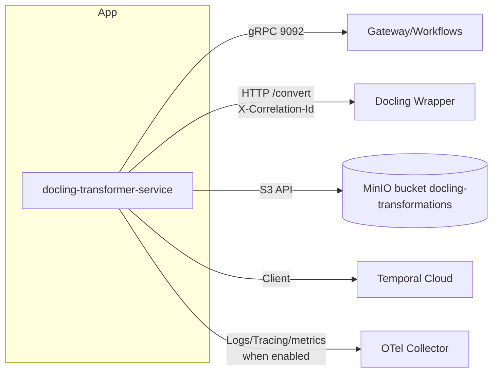

# Infrastructure view

- gRPC порт читается из `service.grpc_port`.
- MinIO/Temporal подключаются как внешние управляемые сервисы, параметры лежат в `config.yaml`.
- Все вызовы содержат `X-Correlation-Id` для трассировки в логах/метриках.
- Трассировка, метрики и логирование активируются флагами `observability.tracingEnabled`, `observability.metricsEnabled`, `observability.loggingEnabled`; при выключении соответствующие провайдеры и middleware не поднимаются.
