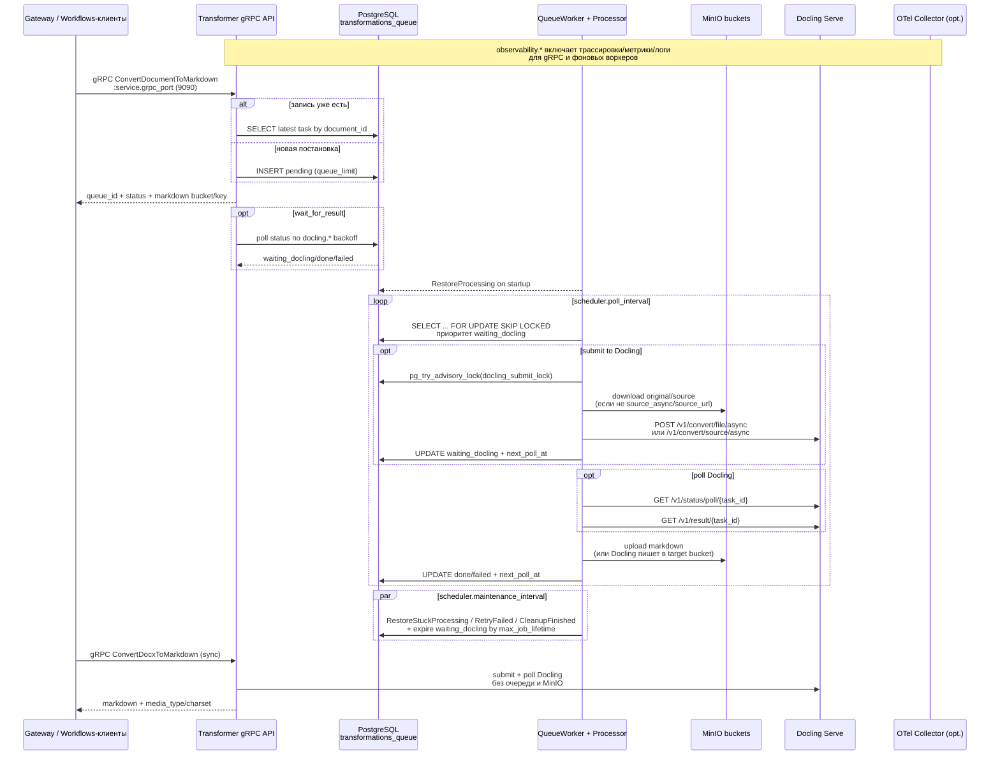

# Infrastructure view

Docling вызывается в одном проходе: после успешного ответа результат сразу сохраняется без дополнительных фаз и ручного мерджа.

- gRPC сервер слушает порт из `service.grpc_port` (в `config/config.yaml` по умолчанию `9090`) и принимает:
  - `ConvertDocumentToMarkdown` — ставит задачу в таблицу `transformations_queue` PostgreSQL. Контроль параллельности выполняется воркером через `service.max_workers`, а приём новых задач ограничивается отдельным лимитом `service.queue_limit` (если задан). При `wait_for_result` сервер блокируется до готовности задачи, опрашивая очередь по backoff-политике `docling.*`.
  - `ConvertDocxToMarkdown` — синхронно проксирует docx-файл (или скачивает `docx_url`) в Docling и возвращает готовый Markdown без постановки в очередь и без MinIO.
- Воркер (QueueWorker/Processor) периодически забирает задания из очереди, восстанавливает их состояние при рестарте (`RestoreProcessing`), скачивает исходный файл из MinIO или по `source_url`, либо в `source_async` режиме передаёт Docling ссылки на бакет/объект. Markdown сохраняется в MinIO (`markdown_bucket` из конфигурации, либо из gRPC запроса). Ключ результата строится в gRPC слое, если не передан явно. Отправки в Docling сериализованы advisory-замком `pg_try_advisory_lock`, чтобы не плодить конкурирующие задачи.
- Docling вызывается по HTTP `POST /v1/convert/file/async` с формой `files` либо `POST /v1/convert/source/async`, куда пробрасываются `X-Correlation-Id`, исходное имя файла (`X-Docling-Source-Filename`), выбранный эндпоинт (`X-Docling-Endpoint`), `X-Api-Key` (если нужен) и минимальные параметры формата (`to_formats`, `from_formats`). Результат запрашивается через `/v1/status/poll/{task_id}` и `/v1/result/{task_id}`. Для `source_async` Docling использует учётные данные `docling.storage.*` для доступа к MinIO: читает исходный объект и при наличии `TargetBucket/ObjectKey` может писать результат напрямую в указанный бакет.
- Планировщик обслуживания (`MaintenanceRunner`) следит за зависшими задачами (time-out на обработку и Docling), переводит их обратно в очередь/ошибку, повторяет попытки для `failed` по задержке и периодически чистит устаревшие выполненные задачи (`cleanup_retention`). Просроченные `waiting_docling` помечаются `failed` после превышения `docling.max_job_lifetime`, зависшие `processing` восстанавливаются или завершаются с учётом `scheduler.max_processing_retries` и `docling.status_max_attempts`.
- Вызовы приходят от cron-воркеров `document-service`, которые по статусам в PostgreSQL решают, какой документ нужно конвертировать; сам сервис не хранит состояния workflow.
- Трассировка, метрики и логирование активируются флагами `observability.tracingEnabled`, `observability.metricsEnabled`, `observability.loggingEnabled`; при выключении соответствующие провайдеры и middleware не поднимаются ни для gRPC сервера, ни для воркера.
