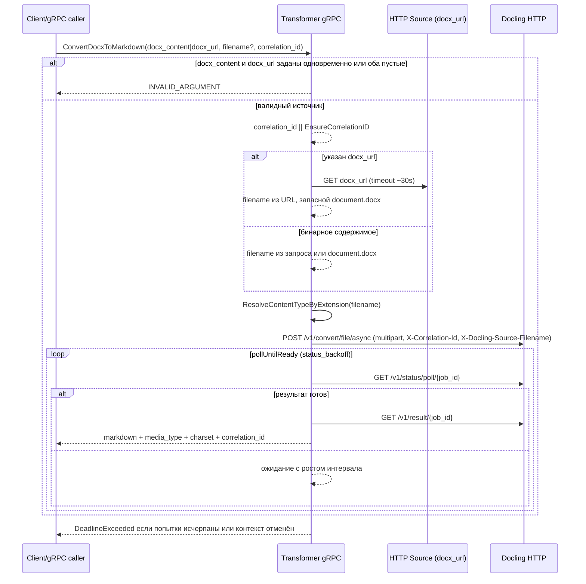

# Sequence diagram

Диаграммы ниже отражают однопроходную конвертацию без вспомогательных фаз и ручного мерджа таблиц.

```mermaid
sequenceDiagram
    participant GW as Gateway/cron job
    participant TR as Transformer gRPC
    participant PG as PostgreSQL Queue
    participant WK as Worker/Maintenance
    participant MN as MinIO
    participant DL as Docling HTTP

    GW->>TR: ConvertDocumentToMarkdown(document_id, original_bucket, original_object_key,<br/>source_bucket/object_key | source_url,<br/>markdown_bucket?, markdown_object_key?, filename_extension?, correlation_id)
    TR->>TR: валидация document_id/original_*,<br/>исключаем source_url против source_bucket/object_key,<br/>markdown_bucket по умолчанию из конфигурации
    TR->>TR: NormalizeExtension(filename_extension | original/source key) + ResolveContentTypeByExtension
    TR->>TR: markdown_object_key по умолчанию через BuildMarkdownKey(original_object_key)
    TR->>TR: параметры markdown_bucket/object_key по умолчанию из конфигурации
    TR->>TR: проверка лимита очереди (CountByStatus)
    TR->>PG: GetLatestByDocument(document_id)
    alt найдена неfailed задача
        TR-->>GW: reuse queue_id/status + ResolveOutput(markdown_bucket/object_key) с учётом сохранённых значений
    else новая задача
        TR->>PG: Enqueue(status=pending, markdown_bucket/object_key,<br/>source_bucket/object_key или source_url, correlation_id)
        TR-->>GW: queue_id, status=pending, markdown_bucket/object_key
    end
    opt wait_for_result=true
        loop WaitForResult (backoff из status_backoff + task.next_poll_at)
            TR->>PG: GetByID(queue_id)
            alt status in [done, failed]
                TR-->>GW: финальный status + markdown_bucket/object_key (с учётом обновлённых значений)
            else
                TR-->>TR: ожидание до next_poll_at или backoff
            end
        end
        TR-->>GW: DeadlineExceeded при исчерпании попыток
    end

    loop workerLoop (MaxWorkers)
        WK->>PG: AcquireBatch(BatchSize) // waiting_docling с наступившим next_poll_at → первыми; при наличии любых waiting_docling pending блокируются
        alt задача с docling_task_id/job_id
            WK->>DL: GET /v1/status/poll/{task_or_job_id} (X-Correlation-Id)
        WK->>PG: UpdateDoclingInfo(docling_task_id/job_id, docling_poll_count++)
        alt status/result готов
            WK->>MN: PUT markdown_object_key в markdown_bucket с media_type
            WK->>PG: MarkDone(status=done, finished_at)
            else статус pending/временная ошибка
                alt превышен лимит поллинга или повтор ошибок
                    WK->>PG: RequeueDoclingWaiting(status=pending, retry_count++, reset docling ids/poll_count,<br/>next_poll_at=requeue_delay)
                else
                    WK->>PG: MarkDoclingWaiting(status=waiting_docling, next_poll_at=exp.backoff)
                end
            end
        else новая конвертация
            WK-->>WK: определить источник (async|download)
            alt useSourceAsync (source_url пуст и известны source_bucket/object_key или включён fallback к оригиналу)
                WK-->>DL: POST /v1/convert/file/async (source_bucket/object_key,<br/>target markdown_bucket/object_key, to_formats/from_formats)
            else синхронная загрузка
                alt источник URL
                    WK->>DL: POST /v1/convert/file/async (multipart, скачанный контент, X-Docling-Source-Filename)
                else объект в MinIO (source_bucket/object_key или original_bucket/object_key)
                    WK->>MN: GET исходный объект
                    WK->>DL: POST /v1/convert/file/async (multipart контент)
                end
            end
            WK->>PG: MarkDoclingWaiting(status=waiting_docling, docling_task_id/job_id,<br/>docling_poll_count=0, next_poll_at=initial backoff)
        end
        alt ошибка обработчика
            WK->>PG: MarkFailed(status=failed, finished_at, error)
        end
    end

    loop maintenanceLoop
        WK->>PG: CountByStatus // метрики очереди
        WK->>PG: ActivateWaiting(now, max_docling_lifetime) // только помечает waiting_docling просроченные как failed
        WK->>PG: RestoreStuckProcessing(processing_timeout, max_retries, max_docling_attempts) // pending или failed при превышении лимитов, сброс docling_* и next_poll_at
        WK->>PG: RetryFailed(olderThan=now-failed_retry_delay, max_failed_retries) // вернуть в pending или оставить failed при превышении лимита
        WK->>PG: CleanupFinished(retention)
    end
```


