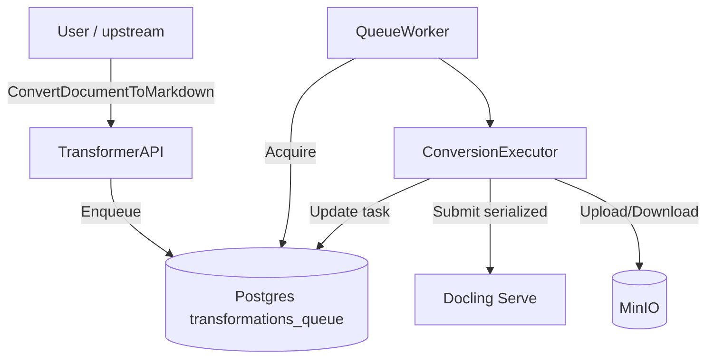
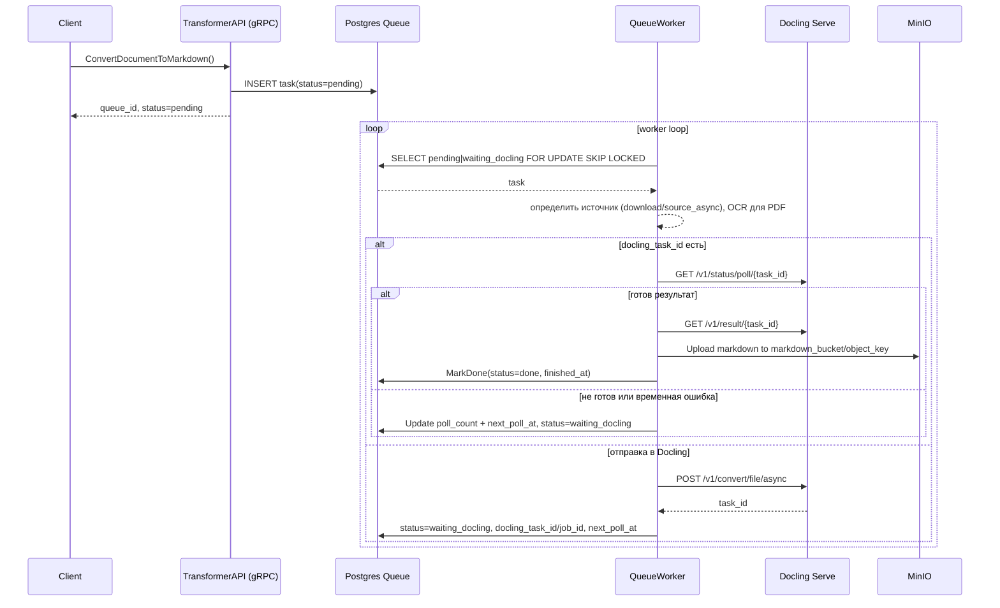
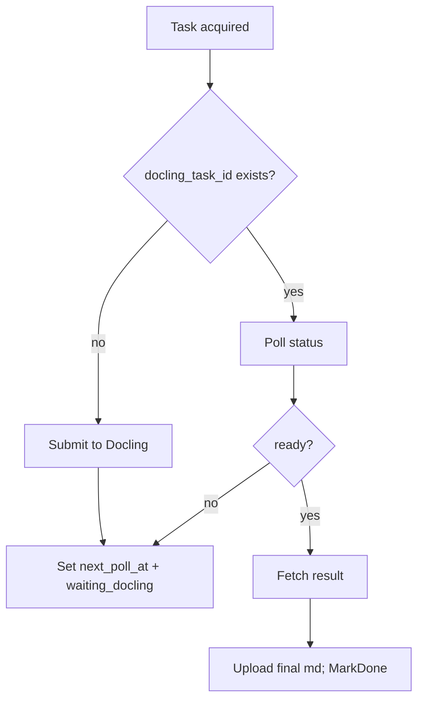

## Цель конвертации для PDF

1. **Текст** оставить “как есть” (по возможности из PDF-текста / без агрессивного OCR-переписывания).
2. **Таблицы** заполнить: в ячейках “✓” должны стать значениями (например `"1"`/`"true"`/`"✓"`).
3. Работать устойчиво: Docling может отдавать пустые таблицы, задачи могут падать при параллельной нагрузке.

---

## Модули и ответственности

### 1) `TransformerAPI` (gRPC слой)

**Use-case:** `ConvertDocumentToMarkdown(document_id, bucket, key)`

- Валидация входа.
- Идемпотентность: если задача уже есть и не failed → вернуть статус + output key.
- Кладёт задачу в очередь.

**Не делает:**

- Никаких вызовов Docling напрямую. Только очередь.

---

### 2) `QueueRepository` (Postgres)

Хранит состояние job и фаз:

- `status`: pending / processing / waiting_docling / done / failed
- `docling_task_id`, `docling_poll_count`, `next_poll_at`

**Важно:** поддержать **глобальный лимит “только 1 активный docling submit одновременно”** (ниже объясню).

---

### 3) `QueueWorker` (оркестратор воркеров)

- Забирает задачи из БД (`AcquireBatch`).
- Вызывает `ConversionExecutor.ProcessTask`.
- Ошибки: MarkFailed или перевод обратно в waiting/pending.

---

### 4) `ConversionExecutor` (главная логика)

Решает:

- как получать исходник (download или source_async)
- нужно ли форсировать OCR (для PDF)
- как собрать и отправить Docling-запрос
- когда загрузить финальный markdown в MinIO и отметить задачу завершённой

---

### 5) `DoclingClient` (converter)

**Единственная точка**, где формируется HTTP запрос в Docling согласно OpenAPI:

- `/v1/convert/file/async`
- `/v1/status/poll/{task_id}`
- `/v1/result/{task_id}`

---

### 6) `DoclingPoller`

- Поллит статус.
- По готовности забирает результат.
- Учитывает backoff/лимит попыток.

---

### 7) Постобработка таблиц

Overlay-проходы убраны: Docling возвращает итоговый markdown за один прогон, без отдельного мерджа таблиц. Дополнительной ручной постобработки нет.

---

## Алгоритм конвертации (подробно)

### Шаг 0. Принятие задачи (gRPC)

1. Получили запрос.
2. Если задача уже существует и не failed → вернуть её статус и output key.
3. Иначе `Enqueue`:
    - `docling_*` пусто

---

### Шаг 1. Worker забрал задачу

`ProcessTask(task)`:

1. Определить тип: `isPDF = ext == "pdf" || contentType == application/pdf`.
2. Если `task.docling_task_id != ""` → перейти в polling (Шаг 3).
3. Подготовить отправку: выбрать режим `source_async`, вычислить имя файла, подобрать OCR язык и pdf_backend (с учётом параметров задачи).
4. Для PDF принудительно включить OCR в запросе (`EnableOCR=true`), для остальных форматов использовать настройки по умолчанию.
5. Отправить задачу в Docling и перейти в ожидание результата.

---

### Шаг 2. Submit в Docling (очередность!)

Критично: **submit только по одному**.

**Почему:** у тебя в логах было 502/404/Task not found/failure при параллельных отправках — это похоже либо на лимит Docling Serve, либо на ingress/timeouts.

**Решение:** в `QueueRepository` (или отдельном `DoclingGate`) добавить “глобальный lock” на submit:

- В БД таблица `docling_submit_lock` с одной строкой.
- `TryAcquireSubmitLock(owner, ttl)` через `SELECT ... FOR UPDATE NOWAIT` или advisory lock.
- Если lock занят → задачу не сабмитим, а откладываем (`next_poll_at = now + small_delay`, status=pending).

После успешного submit — lock освобождаем.

---

### Шаг 3. Polling Docling

`DoclingPoller.Poll(task)`:

1. `GET /v1/status/poll/{task_id}`
- если pending/started/processing → увеличить `docling_poll_count`, выставить `next_poll_at` по backoff
- если success → `GET /v1/result/{task_id}`
- если failure:
    - если можно достать `result` и там `errors[]` — логировать
    - если transient (502/timeout) → retry/backoff
    - если hard failure → MarkFailed (или requeue limited times)
2. После получения результата сразу загрузить markdown в MinIO по `markdown_bucket/object_key` и завершить задачу.

---

### Шаг 4. Завершение

- Забрать результат Docling, отдавая приоритет Markdown.
- Загрузить финальный markdown в `task.MarkdownBucket/task.MarkdownObjectKey`.
- MarkDone; при любой ошибке — MarkFailed с сохранением текста причины.

---

## Use-cases (кратко)

---

## Sequence diagram

---

## Flow диаграмма “Decision + stages”

---

## Как лучше “настроить” Docling именно под этот документ/таблицу

### Конверсия (options)

- `pdf_backend = dlparse_v4` (у тебя в openapi это дефолт и обычно лучше таблиц)
- `table_mode = accurate`
- `table_cell_matching = false` (важно протестировать, это реально часто решает “пустые клетки”)
- `do_table_structure = true` (в openapi есть; у тебя сейчас не отправляется — добавь)
- OCR:
    - `ocr_engine=tesseract` (у тебя установлен)
    - `ocr_lang` как массив: `["rus","osd"]` (можно `["rus","eng","osd"]`)
    - `do_ocr=true` для PDF, чтобы получить заполненные таблицы за один проход

---

## Отдельно: “строго по одной задаче в Docling”

То, что ты хочешь — правильно. Даже при `max_workers=1` у тебя всё равно может быть “две задачи живут”: одна в polling, другая пытается submit. Но тебе нужно именно:

- **submit в docling строго 1 одновременно**
- polling можно делать и параллельно, но если Docling хрупкий — тоже лучше 1.

Самый надёжный вариант: `DoclingSubmitLock` в БД (или pg advisory lock). Это гарантирует порядок даже если завтра поднимешь 2 реплики воркера.
