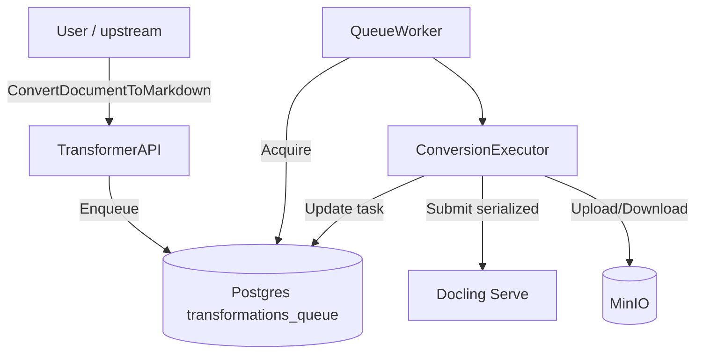
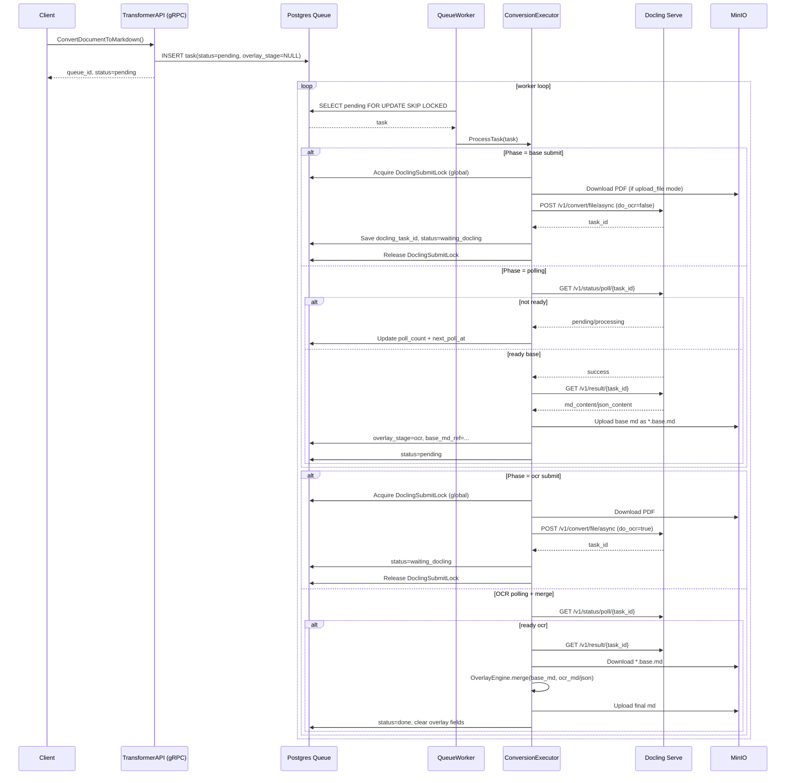
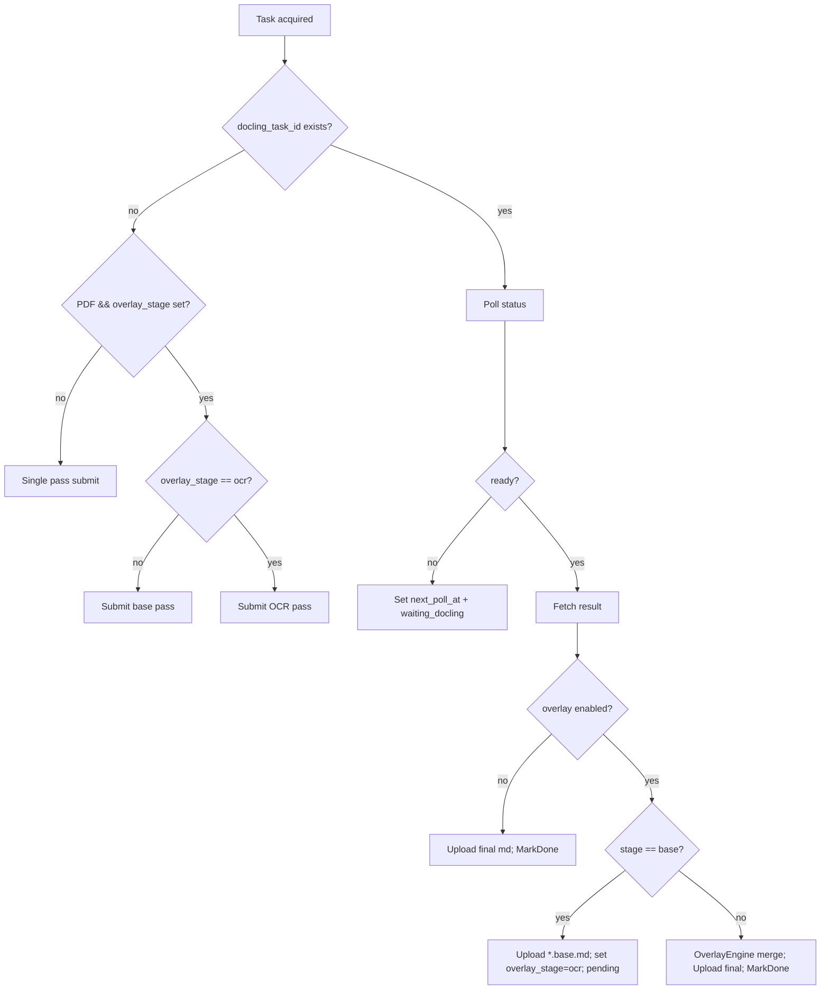

## Цель конвертации для PDF

1. **Текст** оставить “как есть” (по возможности из PDF-текста / без агрессивного OCR-переписывания).
2. **Таблицы** заполнить: в ячейках “✓” должны стать значениями (например `"1"`/`"true"`/`"✓"`).
3. Работать устойчиво: Docling может отдавать пустые таблицы, задачи могут падать при параллельной нагрузке.

---

## Модули и ответственности

### 1) `TransformerAPI` (gRPC слой)

**Use-case:** `ConvertDocumentToMarkdown(document_id, bucket, key)`

- Валидация входа.
- Идемпотентность: если задача уже есть и не failed → вернуть статус + output key.
- Кладёт задачу в очередь.

**Не делает:**

- Никаких вызовов Docling напрямую. Только очередь.

---

### 2) `QueueRepository` (Postgres)

Хранит состояние job и фаз:

- `status`: pending / processing / waiting_docling / done / failed
- `overlay_stage`: "" | "base" | "ocr"
- `base_markdown_*`: ссылка на сохранённый base-результат
- `docling_task_id`, `docling_poll_count`, `next_poll_at`

**Важно:** поддержать **глобальный лимит “только 1 активный docling submit одновременно”** (ниже объясню).

---

### 3) `QueueWorker` (оркестратор воркеров)

- Забирает задачи из БД (`AcquireBatch`).
- Вызывает `ConversionExecutor.ProcessTask`.
- Ошибки: MarkFailed или перевод обратно в waiting/pending.

---

### 4) `ConversionExecutor` (главная логика)

Решает:

- надо ли делать overlay (для PDF в overlay-стадии)
- какую фазу выполнять: base или ocr
- когда сохранять `.base.md`
- когда запускать overlay и писать финальный `.md`

---

### 5) `DoclingClient` (converter)

**Единственная точка**, где формируется HTTP запрос в Docling согласно OpenAPI:

- `/v1/convert/file/async`
- `/v1/status/poll/{task_id}`
- `/v1/result/{task_id}`

---

### 6) `DoclingPoller`

- Поллит статус.
- По готовности забирает результат.
- Учитывает backoff/лимит попыток.

---

### 7) `OverlayEngine` (табличный мердж)

Отдельный пакет, например: `internal/infrastructure/overlay`

- `ExtractVotingTables(mdOrJson)`: выделить таблицы голосования
- `NormalizeRowKey`: ключ строки (№ + ФИО) или fallback (позиция)
- `ExtractMarks`: извлечь “✓/X/•” из OCR-таблицы
- `Overlay(baseTable, ocrTable)`: заполнить только пустые ячейки base
- `RenderBack(md, replacedTables)`: заменить таблицы в исходном base markdown

---

## Алгоритм конвертации (подробно)

### Шаг 0. Принятие задачи (gRPC)

1. Получили запрос.
2. Если задача уже существует и не failed → вернуть её статус и output key.
3. Иначе `Enqueue`:
    - `overlay_stage = NULL`
    - `docling_*` пусто

---

### Шаг 1. Worker забрал задачу

`ProcessTask(task)`:

1. Определить тип:
- `isPDF = ext == "pdf" || contentType == application/pdf`
- `needsOverlay = isPDF && overlay_stage != ""`
1. Если `task.docling_task_id != ""` → перейти в polling (Шаг 3).
2. Если `needsOverlay`:
- если `overlay_stage == ""` или `overlay_stage == "base"` → делаем **Base pass**
- если `overlay_stage == "ocr"` → делаем **OCR pass**
1. Если `!needsOverlay`:
- делаем **Single pass** (обычная конверсия)

---

### Шаг 2. Submit в Docling (очередность!)

Критично: **submit только по одному**.

**Почему:** у тебя в логах было 502/404/Task not found/failure при параллельных отправках — это похоже либо на лимит Docling Serve, либо на ingress/timeouts.

**Решение:** в `QueueRepository` (или отдельном `DoclingGate`) добавить “глобальный lock” на submit:

- В БД таблица `docling_submit_lock` с одной строкой.
- `TryAcquireSubmitLock(owner, ttl)` через `SELECT ... FOR UPDATE NOWAIT` или advisory lock.
- Если lock занят → задачу не сабмитим, а откладываем (`next_poll_at = now + small_delay`, status=pending).

После успешного submit — lock освобождаем.

---

### Шаг 2A. Base pass (текст “как есть”)

Цель: получить максимально “чистый” markdown без OCR-переписывания текста.

Docling options (идея):

- `to_formats=["md","json"]`
- `do_ocr=false`
- `do_table_structure=true`
- `table_mode=accurate`
- `table_cell_matching=false` (часто помогает)
- `pdf_backend=dlparse_v4`
- `ocr_engine=tesseract` (можно не задавать в base, но не мешает)

Submit → `docling_task_id` записать → status=waiting_docling.

---

### Шаг 2B. OCR pass (табличные значения)

Цель: достать “✓” и другие mark-символы из ячеек.

Docling options:

- `to_formats=["md","json"]`
- `do_ocr=true`
- `do_table_structure=true`
- `table_mode=accurate`
- `table_cell_matching=false`
- `pdf_backend=dlparse_v4`
- `ocr_engine=tesseract`
- `ocr_lang=["rus","eng","osd"]` (у тебя реально есть rus/eng/osd)

Submit → `docling_task_id` → status=waiting_docling.

---

### Шаг 3. Polling Docling

`DoclingPoller.Poll(task)`:

1. `GET /v1/status/poll/{task_id}`
- если pending/started/processing → увеличить `docling_poll_count`, выставить `next_poll_at` по backoff
- если success → `GET /v1/result/{task_id}`
- если failure:
    - если можно достать `result` и там `errors[]` — логировать
    - если transient (502/timeout) → retry/backoff
    - если hard failure → MarkFailed (или requeue limited times)

---

### Шаг 4. Обработка результата по фазам

### 4A. Если это Single pass (не overlay)

- Пишем `result.md` в `task.MarkdownBucket/task.MarkdownObjectKey`.
- MarkDone.

### 4B. Если это Base pass результата (overlay включён, stage!=ocr)

- Сохраняем base markdown в `key + ".base.md"` в MinIO.
- В БД: `overlay_stage="ocr"`, `base_markdown_bucket/key` заполнить.
- Перевести задачу обратно в `pending` (чтобы следующий цикл воркера делал OCR pass).

### 4C. Если это OCR pass результата (overlay_stage="ocr")

- Скачать `base.md.base.md`.
- Запустить `OverlayEngine`:
    1. Extract tables from base markdown (позиции строк, заголовки).
    2. Extract tables from OCR output (markdown и/или json tables).
    3. Найти пары таблиц (лучше не по “marks”, а по:
        - схожести заголовков колонок
        - количеству строк
        - наличию “№” и “Ф.И.О.”)
    4. Для каждой пары:
        - key row: (`№`, `ФИО`) — если в OCR таблице “ФИО” распознано хуже, допускаем fuzzy-match, но с порогом.
        - overlay cells: только если base cell пустая, а OCR cell содержит `✓`/`x`/`1`.
    5. Заменить соответствующий кусок markdown таблицы в base.
- Записать финальный markdown в `task.MarkdownObjectKey`.
- MarkDone (и очистить overlay_state поля).

---

## Почему сейчас “таблицы не заполняются” даже после overlay

По твоему примеру, OCR-фаза иногда:

- **падает (`task_status=failure`)** — значит до overlay даже не дошло нормального OCR результата.
- а когда доходит, `merge_total_rows=0` — значит `OverlayEngine` не нашёл таблицы или не распознал колонки.

Чтобы “нашёл”, надо:

1. В `ParseMarkdownTables` сделать более строгий детектор таблиц (учитывать separator line `|---|---|`).
2. В `detectVotingColumns` искать колонки не только по “фио/№”, а ещё по “присутствует/за/против/воздержался/не голосовал”.
3. В OCR-таблице “✓” может оказаться как `v`, `√`, `+`, `x` — завести `normalizeMark()`.

---

## Use-cases (кратко)

---

## Sequence diagram (overlay сценарий)

---

## Flow диаграмма “Decision + stages”

---

## Как лучше “настроить” Docling именно под этот документ/таблицу

### Конверсия (options)

- `pdf_backend = dlparse_v4` (у тебя в openapi это дефолт и обычно лучше таблиц)
- `table_mode = accurate`
- `table_cell_matching = false` (важно протестировать, это реально часто решает “пустые клетки”)
- `do_table_structure = true` (в openapi есть; у тебя сейчас не отправляется — добавь)
- OCR:
    - `ocr_engine=tesseract` (у тебя установлен)
    - `ocr_lang` как массив: `["rus","osd"]` (можно `["rus","eng","osd"]`)
    - `do_ocr=true` во второй фазе

### Overlay (логика)

- Не пытаться “заполнить таблицы из JSON” если Docling JSON таблиц нет.
- Парсить **markdown** OCR-выхода и искать **символы галочек**.
- “✓” нормализовать:
    - `✓`, `✔`, `v`, `V`, `√`, `+`, `x` (иногда tesseract так распознаёт)
- Значение сохранять как `"✓"` или `"1"` — выбери единый формат.

---

## Отдельно: “строго по одной задаче в Docling”

То, что ты хочешь — правильно. Даже при `max_workers=1` у тебя всё равно может быть “две задачи живут”: одна в polling, другая пытается submit. Но тебе нужно именно:

- **submit в docling строго 1 одновременно**
- polling можно делать и параллельно, но если Docling хрупкий — тоже лучше 1.

Самый надёжный вариант: `DoclingSubmitLock` в БД (или pg advisory lock). Это гарантирует порядок даже если завтра поднимешь 2 реплики воркера.
