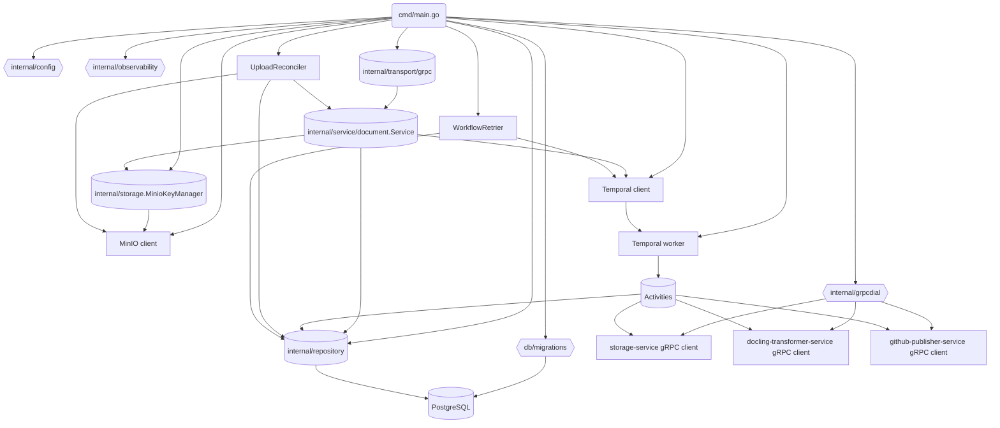

# Code / Module View

Основные части сервиса:

- **Точка входа `cmd/main.go`**: загружает конфигурацию, настраивает логирование и OpenTelemetry, прогоняет миграции PostgreSQL, создаёт MinIO‑клиент и `MinioKeyManager`, инициализирует репозиторий, Temporal‑клиент и gRPC‑клиенты зависимых сервисов (`storage`, `transformer`, `github-publisher`) через `internal/grpcdial`. Регистрирует Temporal worker с активити, поднимает периодические задачи (`UploadReconciler`, `WorkflowRetrier`) и запускает gRPC‑сервер. 【F:cmd/main.go†L1-L137】【F:cmd/main.go†L143-L204】【F:cmd/main.go†L211-L240】
- **`internal/service/document`**: бизнес-логика создания и управления документами, запуск Temporal workflow из `ConfirmUpload`, валидация статусов и генерация ключей через `KeyManager`. Содержит `DocumentProcessingWorkflow` и активити (`AwaitOriginal`, `UploadOriginal`, `ConvertToMarkdown`, `AwaitMarkdown`, `PublishMarkdown`). 【F:internal/service/document/service.go†L1-L226】【F:internal/service/document/workflow.go†L24-L127】
- **Temporal активити**: обращаются к внутреннему репозиторию для обновления статусов, используют gRPC‑клиенты `storage`, `transformer` и `github-publisher`, валидируют наличие исходных и Markdown‑объектов, ждут появления Markdown и публикуют его в GitHub с прокидыванием `x-correlation-id`. 【F:internal/service/document/workflow.go†L131-L334】
- **Фоновые процессы**: `UploadReconciler` по расписанию подтверждает загрузки, если исходный объект появился в MinIO, а `WorkflowRetrier` перезапускает упавшие workflows при ошибках старта, ограничивая число попыток. 【F:internal/service/document/reconciler.go†L14-L103】【F:internal/service/document/retrier.go†L14-L100】
- **`internal/repository`**: CRUD по таблицам `documents`, `document_versions`, `document_status_logs` с контролем переходов статусов и версионирования объектных ключей. 【F:internal/repository/repository.go†L1-L241】
- **`internal/storage`**: `MinioKeyManager` проверяет существование бакетов и строит пути объектных ключей на основе префикса и метаданных документа. 【F:internal/storage/minio.go†L1-L86】
- **`internal/transport/grpc`**: серверная обёртка над proto `DocumentService`, маппинг моделей и логирование `x-correlation-id` для входящих вызовов. 【F:internal/transport/grpc/server.go†L1-L128】
- **Конфигурация и наблюдаемость**: пакеты `internal/config` и `internal/observability` используются на старте для загрузки `config.yaml` и настройки логов/метрик/traces. 【F:cmd/main.go†L1-L83】
