# Code / Module View

```mermaid
flowchart TD
    main("cmd/main.go") --> config{{"pkg/config"}}
    main --> observability{{"pkg/observability"}}
    main --> migrations["db/migrations"]
    main --> repo["internal/infrastructure/postgres.Repository"]
    main --> stageRouter["internal/domain.StageRouter"]
    main --> grpcDial{{"internal/infrastructure/grpcclient"}}
    main --> storageAdapter["internal/infrastructure/storage"]
    main --> usecase["internal/usecase/document.UseCase"]
    main --> activities["internal/service/document.Activities"]
    main --> uploadReconciler["UploadReconciler"]
    main --> processingReconciler["ProcessingReconciler"]
    main --> stageStore["StageWorker store_original"]
    main --> stagePreprocess["StageWorker preprocess_to_docx"]
    main --> stageExtract["StageWorker extract_tables"]
    main --> stageConvert["StageWorker convert_to_markdown"]
    main --> stagePublish["StageWorker publish_to_github"]
    main --> jobFollower["JobFollower"]
    main --> grpcServer["internal/interfaces/grpc.Server"]

    repo --> db[(PostgreSQL: documents, document_versions, document_status_logs, processing_jobs, job_events)]
    grpcDial --> storageClient["storage-service gRPC client"]
    grpcDial --> preprocessClient["preprocess-service gRPC client"]
    grpcDial --> transformerClient["transformer-service gRPC client"]
    grpcDial --> tableExtractorClient["table-extractor-service gRPC client"]
    grpcDial --> publisherClient["github-publisher-service gRPC client"]

    storageAdapter --> storageClient
    usecase --> repo
    usecase --> storageAdapter
    usecase --> stageRouter
    grpcServer --> usecase

    activities --> repo
    activities --> preprocessClient
    activities --> transformerClient
    activities --> tableExtractorClient
    activities --> publisherClient
    activities --> storageClient

    uploadReconciler --> repo
    uploadReconciler --> usecase
    processingReconciler --> repo

    stageStore --> repo
    stagePreprocess --> repo
    stageExtract --> repo
    stageConvert --> repo
    stagePublish --> repo
    stageStore --> activities
    stagePreprocess --> activities
    stageExtract --> activities
    stageConvert --> activities
    stageConvert --> stageRouter
    stagePublish --> activities

    jobFollower --> repo
    jobFollower --> stageRouter
```

Основные части сервиса:

- **Точка входа `cmd/main.go`**: читает конфигурацию, настраивает наблюдаемость, прогоняет миграции и собирает StageRouter из `cfg.Router` для выбора стадий (препроцессинг, извлечение таблиц, артефакты). Далее создаёт PostgreSQL‑репозиторий, gRPC‑клиенты storage/transformer/preprocess/table‑extractor/github‑publisher через `internal/infrastructure/grpcclient`, адаптер хранилища и use case. На их основе инициализируются Activities, reconciler‑ы, StageWorker‑ы для стадий `store_original`/`preprocess_to_docx`/`extract_tables`/`convert_to_markdown`/`publish_to_github`, JobFollower и gRPC‑сервер; фоновые воркеры запускаются параллельно с сервером. 【F:cmd/main.go†L3-L195】
- **Слой use case и gRPC‑интерфейс**: `internal/usecase/document.UseCase` агрегирует `CreateDocument`, `ConfirmUpload`, `UpdateStatus`, чтение и листинг документов, применяя StageRouter для значений по умолчанию и переопределений стратегий/извлечения таблиц, а также адаптер хранилища для валидации загрузки. Сервер `internal/interfaces/grpc.Server` маппит proto `DocumentService` на UseCase и логирует `x-correlation-id`. 【F:internal/usecase/document/usecase.go†L1-L44】【F:internal/usecase/document/create_document.go†L11-L115】【F:internal/usecase/document/confirm_upload.go†L13-L93】【F:internal/interfaces/grpc/server.go†L1-L163】
- **Репозиторий PostgreSQL**: `internal/infrastructure/postgres.Repository` ведёт документы, версии и логи статусов, планирует `processing_jobs`/`job_events`, возвращает зависшие `in_progress` в pending и использует `FOR UPDATE SKIP LOCKED` при выдаче очередей. 【F:internal/infrastructure/postgres/repository.go†L19-L220】【F:internal/infrastructure/postgres/repository.go†L509-L660】
- **Интеграционные Activities**: оборачивают gRPC‑клиенты preprocess/transformer/table‑extractor/github‑publisher и storage. Умеют подтверждать сохранение оригинала, отправлять и опрашивать препроцессинг, запускать Docling‑конвертацию, извлекать таблицы с загрузкой артефактов/markdown, мерджить markdown с таблицами и публиковать в GitHub с учётом таймаутов/ретраев. 【F:internal/service/document/activities.go†L31-L370】【F:internal/service/document/activities.go†L371-L520】【F:internal/service/document/activities.go†L521-L707】
- **Фоновые исполнители и маршрутизация стадий**: UploadReconciler подтверждает загрузки после выдержки, ProcessingReconciler возвращает зависшие задачи. StageWorker‑ы обслуживают отдельные стадии (включая препроцессинг и извлечение таблиц), используют backoff и StageRouter для решения, нужно ли запускать table extractor после Docling. JobFollower читает завершённые задачи, выбирает следующую стадию через StageRouter (`preprocess_to_docx`/`extract_tables`/`convert_to_markdown`/`publish_to_github`) или помечает документ как Failed. 【F:internal/service/document/reconciler.go†L15-L104】【F:internal/service/document/processing_reconciler.go†L13-L182】【F:internal/service/document/stage_worker.go†L20-L620】【F:internal/service/document/stage_worker.go†L797-L809】【F:internal/service/document/job_follower.go†L28-L239】
