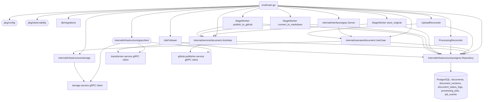

# Code / Module View

Основные части сервиса:

- **Точка входа `cmd/main.go`**: читает конфигурацию из `pkg/config`, включает логирование и трейсинг через `pkg/observability`, прогоняет миграции, собирает PostgreSQL‑репозиторий, gRPC‑клиенты (storage/transformer/github-publisher) через `internal/infrastructure/grpcclient`, адаптер хранилища и use case. Затем инициализирует Activities, фоновые воркеры (reconciler-ы, stage‑воркеры по стадиям `store_original`/`convert_to_markdown`/`publish_to_github`, job follower) и поднимает gRPC‑сервер. 【F:cmd/main.go†L3-L185】
- **Слой use case и gRPC‑интерфейс**: `internal/usecase/document.UseCase` агрегирует операции `CreateDocument`, `ConfirmUpload`, `UpdateStatus`, получение и листинг документов, опираясь на репозиторий и адаптер хранилища. Сервер `internal/interfaces/grpc.Server` маппит proto `DocumentService` на UseCase и логирует `x-correlation-id`. 【F:internal/usecase/document/usecase.go†L1-L44】【F:internal/interfaces/grpc/server.go†L1-L163】
- **Репозиторий PostgreSQL**: `internal/infrastructure/postgres.Repository` ведёт таблицы документов, версий и логов статусов, добавляет и обновляет `processing_jobs` с событиями в `job_events`, использует `FOR UPDATE SKIP LOCKED` при выдаче pending‑задач и умеет восстанавливать зависшие `in_progress`. 【F:internal/infrastructure/postgres/repository.go†L19-L220】【F:internal/infrastructure/postgres/repository.go†L509-L660】
- **Фоновые исполнители**: UploadReconciler обрабатывает документы в статусе `Uploaded`, вызывает `ConfirmUpload` после проверки давности и наличия объекта; ProcessingReconciler возвращает зависшие задачи в pending; StageWorker-ы подбирают pending‑очереди по стадиям, вызывают Activities и умеют переоткладывать/бэкофить; JobFollower реагирует на завершённые/ошибочные задачи, ставит следующую стадию или помечает документ `Failed`. 【F:internal/service/document/reconciler.go†L15-L104】【F:internal/service/document/processing_reconciler.go†L13-L182】【F:internal/service/document/stage_worker.go†L20-L312】【F:internal/service/document/job_follower.go†L28-L186】
- **Интеграционные Activities**: инкапсулируют вызовы gRPC‑трансформера и GitHub‑паблишера, проверяют текущий статус документа и выполняют переходы `Uploaded → StoredOriginal → ConvertedToMarkdown → PublishedToGitHub` (или `Failed`), прокидывая корреляционный ID и версии объектов хранилища. 【F:internal/service/document/activities.go†L31-L218】【F:internal/service/document/stage_worker.go†L96-L291】
