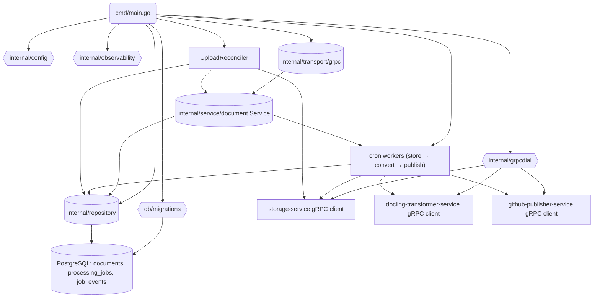

# Code / Module View

Основные части сервиса:

- **Точка входа `cmd/main.go`**: загружает конфигурацию, настраивает логирование и OpenTelemetry, прогоняет миграции PostgreSQL, инициализирует репозиторий и gRPC‑клиенты зависимых сервисов (`storage`, `transformer`, `github-publisher`) через `internal/grpcdial`. Поднимает периодические задачи (`UploadReconciler`, cron‑воркеры по стадиям store/convert/publish) и запускает gRPC‑сервер. Прямые SDK MinIO/GitHub/Docling не используются. 【F:cmd/main.go†L1-L137】【F:cmd/main.go†L143-L204】【F:cmd/main.go†L211-L240】
- **`internal/service/document`**: бизнес-логика создания и управления документами, постановка задач в `processing_jobs`, валидация статусов и работа с gRPC-исполнителями стадий. Сервис остаётся источником статусов `UPLOADED → STORED_ORIGINAL → CONVERTED_TO_MARKDOWN → PUBLISHED_TO_GITHUB → FAILED` в таблице `documents`. 【F:internal/service/document/service.go†L1-L226】【F:internal/infra/postgres/repository.go†L1-L241】
- **Крон-воркеры**: читают очередь `processing_jobs` через `SELECT ... FOR UPDATE SKIP LOCKED`, учитывают расписание `next_run_at`, обновляют статус задач и пишут события в `job_events`. Для конвертации и публикации используют gRPC‑клиенты `storage`, `transformer` и `github-publisher`, прокидывая `x-correlation-id` из `payload`. 【F:internal/service/document/reconciler.go†L14-L103】【F:internal/service/document/retrier.go†L14-L100】
- **`internal/transport/grpc`**: серверная обёртка над proto `DocumentService`, маппинг моделей и логирование `x-correlation-id` для входящих вызовов. 【F:internal/transport/grpc/server.go†L1-L128】
- **Конфигурация и наблюдаемость**: пакеты `internal/config` и `internal/observability` используются на старте для загрузки `config.yaml` и настройки логов/метрик/traces. 【F:cmd/main.go†L1-L83】
