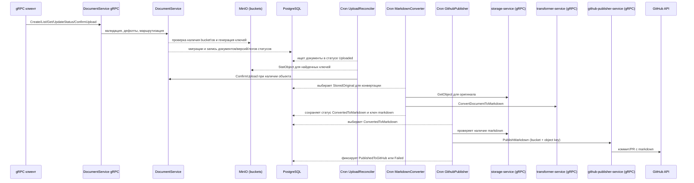

# Инфраструктурная схема

- PostgreSQL хранит таблицы `documents`, `document_versions`, `document_status_logs`.
- MinIO используется для проверки существования bucket'ов, генерации ключей и статусов загрузки: файлы кладёт `storage-service`/`transformer-service`, а `UploadReconciler` проверяет наличие объектов напрямую через MinIO.
- Цепочка cron-воркеров (UploadReconciler → MarkdownConverter → GithubPublisher) читает статусы из PostgreSQL и двигает документ по шагам без Temporal.
- PublishMarkdown выполняется через gRPC вызов `github-publisher-service`; прямой вызов GitHub API в `document-service` не используется.
- Корреляционный идентификатор передаётся через метаданные gRPC `x-correlation-id`, прокидывается в цепочку cron-задач и логирование.
