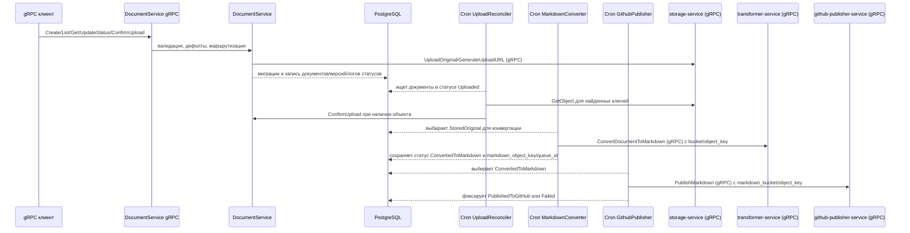

# Инфраструктурная схема

- PostgreSQL хранит таблицы `documents`, `document_versions`, `document_status_logs`.
- MinIO обслуживается `storage-service`: загрузка/выдача объектов выполняется через его gRPC API (`UploadOriginal`/`UploadMarkdown`/`GetObject`), а `UploadReconciler` использует этот API для проверки наличия исходников.
- Цепочка cron-воркеров (UploadReconciler → MarkdownConverter → GithubPublisher) читает статусы из PostgreSQL и двигает документ по шагам; Document-service не использует прямые SDK MinIO/GitHub/Docling.
- Все фоновые задачи запускаются единым раннером на `errgroup.WithContext`: любая ошибка воркера мгновенно отменяет общий контекст и останавливает остальные задачи. gRPC‑сервер подписан на тот же контекст и завершается при сбое фонового контура.
- PublishMarkdown выполняется через gRPC вызов `github-publisher-service`; прямой вызов GitHub API в `document-service` не используется.
- Корреляционный идентификатор передаётся через метаданные gRPC `x-correlation-id`, прокидывается в цепочку cron-задач и логирование.
