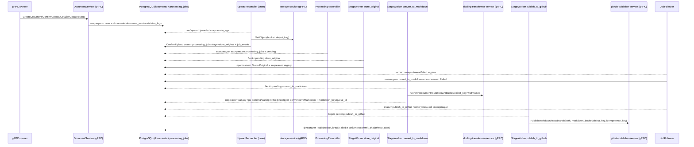

# Инфраструктурная схема

- PostgreSQL хранит таблицы `documents`, `document_versions`, `document_status_logs`, очередь `processing_jobs` и аудит `job_events`.
- MinIO обслуживается `storage-service`: Document-service не генерирует URL для загрузки, а при `ConfirmUpload`/`UploadReconciler` лишь валидирует наличие объекта через `GetObject` по сохранённым `bucket`/`object_key`.
- Фоновые процессы состоят из `UploadReconciler` (ищет `Uploaded` и переиспользует ConfirmUpload), `ProcessingReconciler` (возвращает зависшие задачи), stage worker-ов `store_original`/`convert_to_markdown`/`publish_to_github` и `JobFollower`, который ставит следующую стадию или переводит документ в `Failed`. Очередь задач — `processing_jobs`, переходы статусов фиксируются в таблицах документов.
- Все фоновые задачи запускаются единым раннером на `errgroup.WithContext`: любая ошибка воркера мгновенно отменяет общий контекст и останавливает остальные задачи. gRPC‑сервер подписан на тот же контекст и завершается при сбое фонового контура.
- PublishMarkdown выполняется через gRPC вызов `github-publisher-service`; прямой вызов GitHub API в `document-service` не используется. Конвертация вызывается через `docling-transformer-service`, сохранение оригинала ограничивается сменой статуса, без прямого доступа к MinIO.
- Корреляционный идентификатор передаётся через метаданные gRPC `x-correlation-id` и прокидывается в цепочку cron-задач, вызовы конвертера/паблишера и логирование.
