# Инфраструктурная схема

```mermaid
sequenceDiagram
    participant Client as gRPC клиент
    participant API as DocumentService (gRPC)
    participant DB as PostgreSQL (documents + processing_jobs)
    participant UploadReconciler as UploadReconciler (cron)
    participant Storage as storage-service (gRPC)
    participant ProcessingReconciler as ProcessingReconciler
    participant StoreWorker as StageWorker store_original
    participant JobFollower as JobFollower + StageRouter
    participant PreprocessWorker as StageWorker preprocess_to_docx
    participant Preprocess as preprocess-service (gRPC)
    participant ConvertWorker as StageWorker convert_to_markdown
    participant Transformer as docling-transformer-service (gRPC)
    participant TablesWorker as StageWorker extract_tables
    participant TableExtractor as table-extractor-service (gRPC)
    participant PublishWorker as StageWorker publish_to_github
    participant Publisher as github-publisher-service (gRPC)

    Client->>API: CreateDocument/ConfirmUpload/Get/List/UpdateStatus
    API->>DB: миграции + запись documents/document_versions/status_logs
    UploadReconciler-->>DB: выбирает Uploaded старше min_age с bucket/object_key
    UploadReconciler->>Storage: GetObject(bucket, object_key) валидация наличия
    UploadReconciler->>DB: ConfirmUpload ставит processing_jobs stage=store_original + job_events
    ProcessingReconciler-->>DB: возвращает застрявшие processing_jobs в pending
    StoreWorker-->>DB: берёт pending store_original
    StoreWorker->>DB: проставляет StoredOriginal и закрывает задачу
    JobFollower-->>DB: читает завершённые/failed задачи
    JobFollower->>DB: планирует preprocess_to_docx/extract_tables/convert_to_markdown по StageRouter или помечает Failed
    PreprocessWorker-->>DB: берёт pending preprocess_to_docx
    PreprocessWorker->>Preprocess: SubmitPreprocess(source->target, wait=false)
    PreprocessWorker-->>Preprocess: GetPreprocessStatus(job_id)
    PreprocessWorker-->>DB: фиксирует статус/ошибку и завершает задачу
    JobFollower-->>DB: ставит convert_to_markdown с preprocessed bucket/key после preprocess
    ConvertWorker-->>DB: берёт pending convert_to_markdown
    ConvertWorker->>Transformer: ConvertDocumentToMarkdown(bucket/object_key, wait=false)
    ConvertWorker-->>DB: переносит задачу при pending/waiting либо фиксирует markdown_key/queue_id
    JobFollower-->>DB: при готовности ставит extract_tables (если стратегия/детекция) или publish_to_github
    TablesWorker-->>DB: берёт pending extract_tables
    TablesWorker->>TableExtractor: ExtractTablesFromPdf(bucket/key,prefix, wait=false)
    TablesWorker-->>TableExtractor: GetTableExtractionJob(queue_id)
    TablesWorker->>Storage: GetObject/UploadMarkdown для merge docling + tables markdown
    TablesWorker-->>DB: фиксирует ConvertedToMarkdown + artifacts_prefix/queue_id
    PublishWorker-->>DB: берёт pending publish_to_github
    PublishWorker->>Publisher: PublishMarkdown(repo/branch/path, markdown_bucket/object_key, idempotency_key)
    PublishWorker-->>DB: фиксирует PublishedToGitHub/Failed и события (commit_sha/pr/retry_after)
```

- PostgreSQL хранит таблицы `documents`, `document_versions`, `document_status_logs`, очередь `processing_jobs` и аудит `job_events`; в payload задач сохраняются `queue_id`/`etag`/`artifacts_prefix`/`markdown_object_key` для стадий preprocess/docling/table-extractor/publish. Флаги `conversion_strategy` и `extract_tables` лежат в `documents` и влияют на маршрут обработки.
- MinIO обслуживается через `storage-service`: Document-service не генерирует URL для загрузки, а при `ConfirmUpload`/`UploadReconciler` валидирует наличие объекта (`GetObject`). В цепочке извлечения таблиц `StageWorker extract_tables` скачивает Markdown/артефакты и заливает объединённый Markdown через `UploadMarkdown`, не обращаясь к S3 напрямую.
- Фоновые процессы: `UploadReconciler` (ищет `Uploaded` и повторно вызывает ConfirmUpload), `ProcessingReconciler` (возвращает зависшие задачи), stage worker-ы `store_original`/`preprocess_to_docx`/`extract_tables`/`convert_to_markdown`/`publish_to_github` и `JobFollower`, который через `StageRouter` ставит следующую стадию или переводит документ в `Failed`. Очередь задач — `processing_jobs`, переходы фиксируются в таблицах документов и `job_events`.
- Все фоновые задачи и gRPC‑сервер запускаются под общим контекстом `errgroup.WithContext`: сбой любого воркера завершает остальные задачи и останавливает сервис.
- Внешние gRPC‑зависимости: валидация и merge Markdown через `storage-service`, препроцессинг (DOCX из PDF) через `preprocess-service`, конвертация в Markdown через `docling-transformer-service`, извлечение таблиц через `table-extractor-service`, публикация в GitHub через `github-publisher-service`; прямых HTTP-запросов к GitHub или MinIO сервис не делает.
- Корреляционный идентификатор передаётся через метаданные gRPC `x-correlation-id` и прокидывается в цепочку cron-задач, вызовы препроцессора/конвертера/паблишера и логирование.
