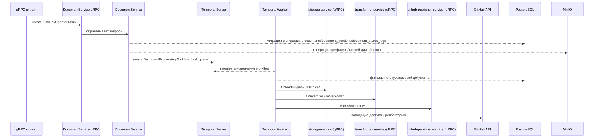

# Инфраструктурная схема

- PostgreSQL хранит таблицы `documents`, `document_versions`, `document_status_logs`.
- MinIO используется только для генерации ключей/папок; загрузка файлов производится внешними сервисами storage-service/transformer-service.
- Temporal Client в сервисе запускает workflow, а Temporal Worker исполняет его и вызывает внешние gRPC‑сервисы.
- PublishMarkdown взаимодействует с GitHub Publisher Service, перед этим worker напрямую валидирует доступ к GitHub API.
- Корреляционный идентификатор передаётся через метаданные gRPC `x-correlation-id`, прокидывается в workflow и пишется в логах сервера.
