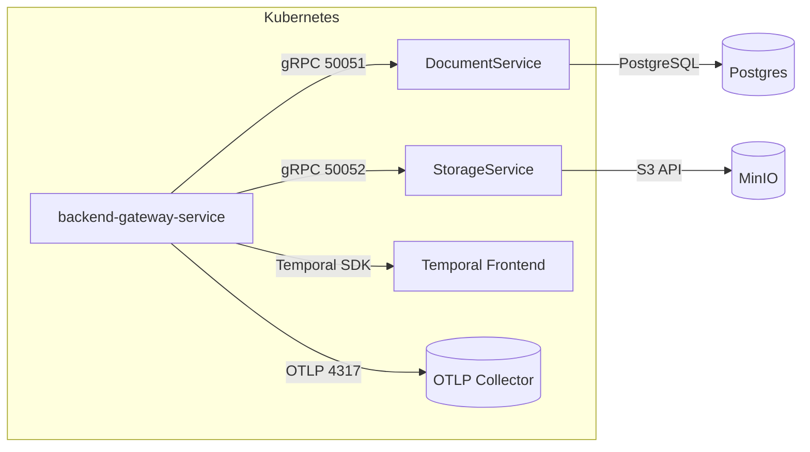

# infrastructure

Gateway дергает `StorageService.GenerateUploadURL` по gRPC (порт 50052), чтобы получить `uploadUrl`, `bucket` и `objectKey` для прямой загрузки в MinIO. TTL presigned ссылки задаётся `uploads.signedUrlTtlSeconds`, correlation-id сохраняется как `x-amz-meta-correlation-id`.

