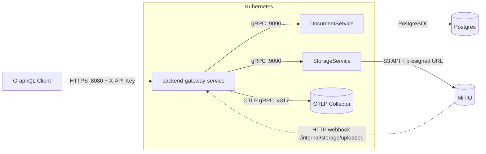

# infrastructure

Сервис принимает GraphQL-запросы на `:8080/query` с обязательным заголовком `X-API-Key`, отдаёт Playground по `:8080/playground` и прокидывает `x-correlation-id` во все gRPC-вызовы. Gateway обращается к `storage-service.GenerateUploadURL` (порт `9090`), чтобы получить `uploadUrl`, `bucket` и `objectKey` для прямой загрузки файла в MinIO; TTL пресайна берётся из `uploads.signedUrlTtlSeconds`. События MinIO с метаданными `x-amz-meta-correlation-id` отправляются на webhook `/internal/storage/uploaded`, после чего gateway подтверждает загрузку через `document-service.ConfirmUpload`.

