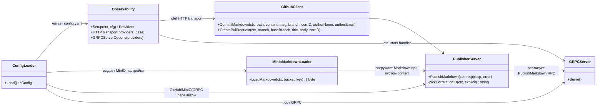

# Code view

Диаграмма отражает основные модули и их связи в актуальном коде `github-publisher-service`.

Основные моменты, отражённые на схеме:

- `cmd/main.go` загружает конфигурацию, инициализирует OpenTelemetry провайдеры, создаёт MinIO‑клиент для загрузки Markdown и HTTP‑клиент с otel-транспортом, затем регистрирует gRPC‑сервер `GithubPublisherService` на указанном порту.
- `PublisherServer` валидирует входные поля, подставляет owner/repository/branch/baseBranch из конфигурации, подтягивает Markdown из MinIO, если `content` пуст, публикует коммит и при необходимости открывает Pull Request.
- Корреляционный идентификатор берётся либо из запроса, либо из входящих gRPC‑метаданных с заголовком из конфигурации (`X-Correlation-ID` по умолчанию) и передаётся GitHub API через заголовок.
