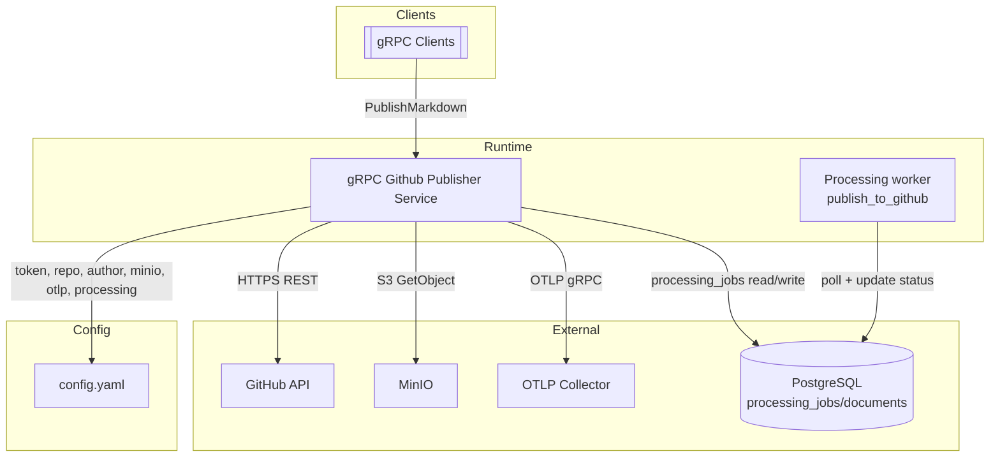

# Infrastructure

## Observability и логирование
- Включение дебага: `logging.level: debug` в `config/config.yaml` (по умолчанию `info`); для локальных запусков можно переключить `logging.encoding` в `console`, по умолчанию используется `json` с датой в ISO8601.
- gRPC слой и воркер пишут в тот же zap‑логгер (`zap.ReplaceGlobals`), поэтому все записи попадают в stdout/стрим, подключенный к OTLP коллектору при включённых логах.
- Публикации фиксируют `correlation_id`, `attempt`, `max_attempts`, `initial_backoff`, `max_backoff`, `status`, `error_code`, `commit_sha`, `pr_number`, `retry_in` (для временных ошибок); воркер в ошибках дописывает `task_id`, `stage`, `attempts`, `document_id`, `correlation_id`, `status` и ошибку запроса.
