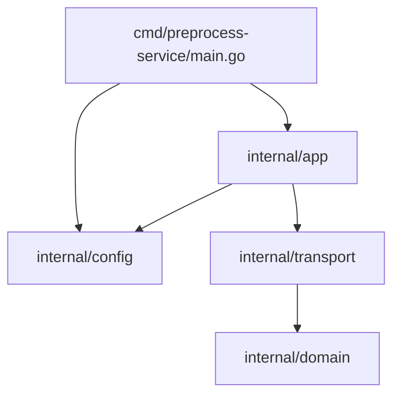

# Обзор кода

- `main` отвечает за загрузку конфигурации и корректное завершение по сигналам.
- `config` инкапсулирует чтение YAML и структуру секции `preprocess`.
- `app` связывает доменные и транспортные слои.
- `transport` предоставляет health‑endpoint и готов к расширению gRPC/HTTP API.
- `domain` хранит сущности и базовую валидацию заданий на обработку.
