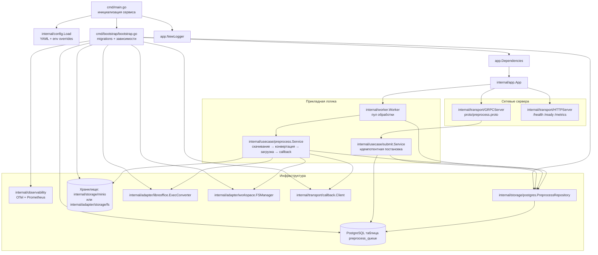

# Обзор кода

- `cmd/main.go` загружает конфигурацию (`internal/config` с чтением YAML и env‑переопределениями), поднимает логгер, прогоняет миграции (`db/migrations`), собирает зависимости в `bootstrap` (OTel, пул Postgres, хранилище MinIO/FS, LibreOffice‑конвертер, файловый workspace, HTTP‑клиент callback) и стартует приложение.
- `internal/app` создаёт gRPC сервер по контракту `proto/preprocess.proto`, HTTP health/ready/metrics сервер, а также фонового воркера.
- `internal/transport`:
  - gRPC‑хендлер `PreprocessHandler` использует `submit.Service` для идемпотентной постановки задач и чтения статуса;
  - HTTP сервер отдаёт `/health`, `/ready` (ping Postgres) и `/metrics` с метриками из `internal/observability`;
  - middleware добавляет корреляционный идентификатор и метрики.
- `internal/usecase/submit.Service` формирует `PreprocessJob`, подставляет `target_bucket`/`target_key` по умолчанию и сохраняет через `PreprocessRepository`; повторный вызов с тем же `source_bucket`/`source_key`/`source_etag` возвращает существующую задачу.
- `internal/worker` периодически вызывает `PreprocessRepository.RequeueStuck/NextForProcessing`, ограничивает параллельность и передаёт задачи в `internal/usecase/preprocess.Service`.
- `internal/usecase/preprocess.Service` готовит workspace, скачивает исходник через адаптер хранилища (MinIO или локальный FS), конвертирует его LibreOffice в DOCX, кладёт результат в целевой bucket через адаптер, обновляет статус в `PreprocessRepository` и отправляет callback с итогом.
- `internal/domain` содержит модель `PreprocessJob`, статусы (`pending/processing/done/failed/stopped`), retry‑политику и типизированные коды ошибок для расчёта `next_run_at` и остановки задач.
- `db/migrations` создают таблицу `preprocess_queue` с полями для статуса, расписания повторов, ссылок на исходный объект и результата; основной репозиторий — `internal/storage/postgres.PreprocessRepository` (есть ин‑мемори реализация для тестов).
