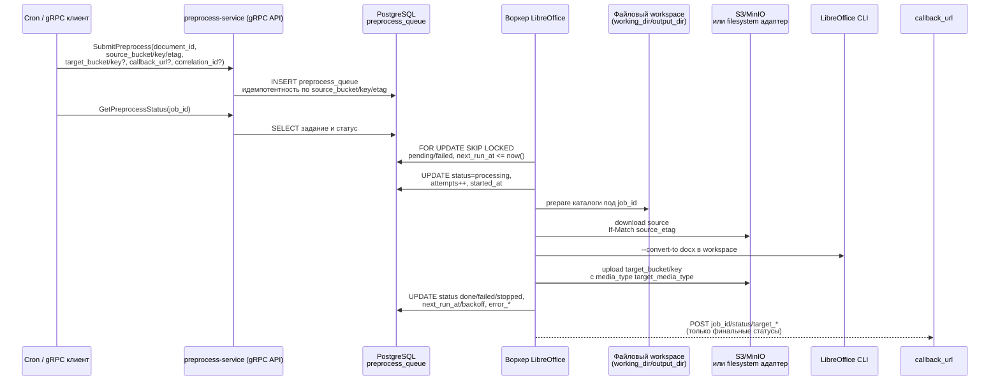

# Infrastructure view

- Таблица `preprocess_queue` содержит `job_id` (UUID), `document_id`, координаты источника (`source_bucket/source_key/source_etag`),
  результата (`target_bucket/target_key/target_media_type`), `callback_url`, `correlation_id`, статусы (`pending|processing|done|failed|stopped`),
  счётчики `attempts/max_attempts`, расписание `next_run_at`, `started_at/finished_at`, поля ошибок (`error_code/error_message/error_details`),
  `created_at/updated_at`.
- Индексы: `(status, next_run_at)` для выборки в воркере, `(source_bucket, source_key)` и уникальный `(source_bucket, source_key, source_etag)`
  для идемпотентности `SubmitPreprocess`. Встроенные миграции накатываются при старте (`cmd/bootstrap.RunMigrations`).
- Распределённый замок на воркер: перед выборкой задач сервис захватывает `pg_try_advisory_lock` с фиксированным ключом. Это гарантирует, что в кластере одновременно активна только одна реплика воркера; дополнительные реплики завершатся с ошибкой старта.
- Воркер перед выборкой реанимирует застрявшие задачи (`processing` старше `convert_timeout + backoff`), затем берёт `pending/failed` с
  `next_run_at <= now()` через `FOR UPDATE SKIP LOCKED`, увеличивает `attempts` и обновляет статус.
- Загрузка/выгрузка файлов идёт через S3-адаптер MinIO (или файловый адаптер при `preprocess.storage_mode=filesystem`) с использованием
  временного workspace (`working_dir`/`output_dir`). `source_etag` применяется как If-Match, LibreOffice вызывается локально через CLI.
- Callback (`POST job_id/status/target_*`) шлётся только после финального статуса `done` или `stopped` c ограниченным числом ретраев;
  HTTP-сервер сервиса параллельно отдаёт `/health`, `/ready` (ping PostgreSQL) и `/metrics` (OTel/Prometheus).
