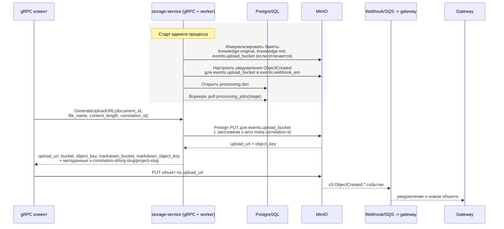

# Инфраструктура

- gRPC-сервер и воркер опроса `processing_jobs` запускаются в одном процессе, подключаясь к PostgreSQL по `processing.dsn`.
- Все бакеты (`knowledge-original`, `knowledge-md` и кастомный `events.upload_bucket`) создаются при старте, если отсутствуют, и остаются приватными.
- Если `events.upload_bucket` не задан, для подписанных ссылок используется `minio.buckets.knowledge_docx`; при другом значении он добавляется к списку инициализируемых бакетов.
- Ключи объектов формируются по шаблону `org/<org_slug>/project/<project_slug>/year=YYYY/month=MM/day=DD/<uuid>/<document_id>.<ext>` с обязательным промежуточным UUID.
- `GenerateUploadURL` подписывает PUT-запросы MinIO с заголовком `x-amz-meta-correlation-id`, чтобы сохранить трассировку загрузки.
- Уведомления MinIO о загрузках (`s3:ObjectCreated:*`) перенаправляются в gateway через ARN `events.webhook_arn`.
