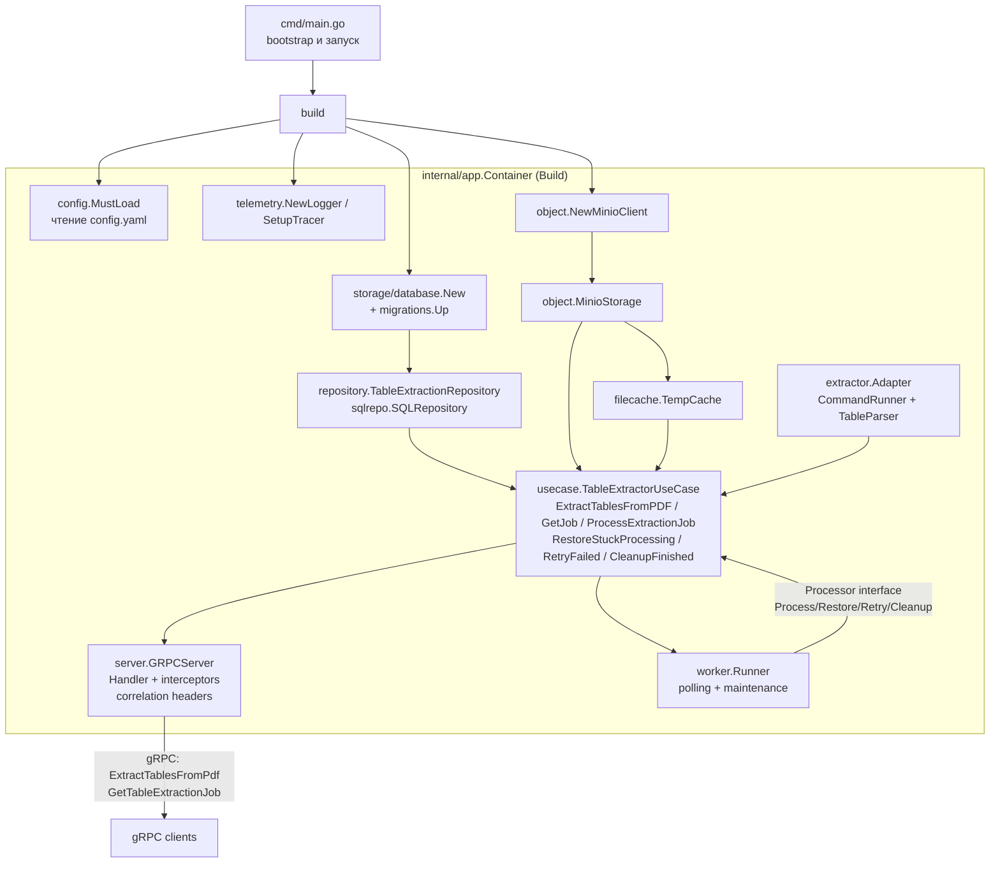

# Code / Module View

Документ отражает фактическую структуру модулей `table-extractor-service` и их взаимодействие на уровне кода.

### Ключевые элементы

- **cmd/main.go** — точка входа: вызывает `app.Build`, запускает gRPC‑сервер и воркеры через `errgroup`.
- **internal/app.Container** — собирает зависимости: конфиг (`config.MustLoad`), логгер и tracer (`telemetry`), MinIO‑клиент (`object.NewMinioClient`), подключение к БД (`storage/database.New`), миграции (`db/migrations`), репозиторий очереди (`sqlrepo.SQLRepository`), клиенты хранения (`object.MinioStorage`, `filecache.TempCache`), poppler‑адаптер (`extractor.Adapter`), use‑case (`usecase.TableExtractorUseCase`), gRPC‑слой (`server.GRPCServer` + `Handler`), воркер (`worker.Runner`) и функцию `Cleanup`.
- **internal/server** — gRPC сервер с интерсепторами и корреляцией: `Handler` преобразует запросы `ExtractTablesFromPdf`/`GetTableExtractionJob` в вызовы use‑case, выставляет `x-correlation-id`.
- **internal/usecase.TableExtractorUseCase** — валидирует входные данные, управляет очередью (`UpsertOrGetActive`, `SelectPendingBatchForUpdate`), кеширует/скачивает исходники через `filecache.TempCache`, запускает poppler‑пайплайн через `extractor.Adapter`, загружает артефакты в MinIO, переводит статусы (`pending → processing → done/failed/failed_retryable`), выполняет обслуживание очереди (`RestoreStuckProcessing`, `RetryFailed`, `CleanupFinished`). Реализует интерфейс `Processor` для воркера и `ExtractionUseCase` для gRPC.
- **internal/worker.Runner** — периодически вызывает методы use‑case (обработка задач, восстановление зависших, повторение ошибок, очистка) с бэк‑оффом и таймаутами.
- **internal/extractor.Adapter** — запускает внешние утилиты poppler (`pdfinfo`, `pdftotext`, `pdftoppm`) через `CommandRunner`, парсит таблицы (`TableParser`, включая режим `voting`), формирует артефакты (JSON/Markdown/manifest).
- **internal/storage** — `object.MinioStorage` для загрузки/выгрузки объектов с таймаутами и корреляцией; `filecache.TempCache` скачивает PDF из MinIO, URL или локального пути во временный файл; `storage/database` создаёт подключение к PostgreSQL/SQLite.
- **internal/repository/sqlrepo** — доступ к таблице `table_extraction_queue`: upsert задач, выдача батча `pending` с `FOR UPDATE SKIP LOCKED` (PostgreSQL), обновление статусов/попыток, очистка и повторы.
- **proto/backend/tableextractor/v1** — gRPC контракт, который реализует `server.Handler`.

