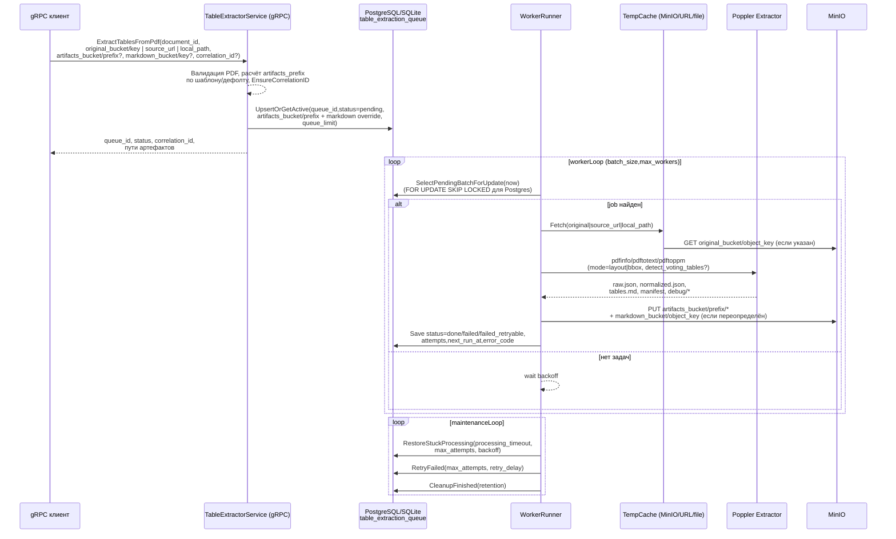

# Инфраструктура `table-extractor-service`

- gRPC-сервер и воркер запускаются единым процессом (`cmd/main.go`) через `errgroup`: после сборки контейнера поднимается gRPC на `service.port`, параллельно стартует `worker.Runner`, а при отмене контекста оба контура останавливаются корректно. Миграции (`db/migrations`) применяются сразу после подключения к БД.【F:backend/table-extractor-service/cmd/main.go†L12-L55】【F:backend/table-extractor-service/internal/app/container.go†L27-L128】
- База данных может быть PostgreSQL или SQLite; подключение настраивается через `database.New`, при старте выполняется `Ping`, затем миграции. Основная таблица — `table_extraction_queue` с уникальностью по `document_id` в статусах `pending/processing`, поддержкой `queue_limit` и `FOR UPDATE SKIP LOCKED` для Postgres.【F:backend/table-extractor-service/internal/storage/database/database.go†L15-L64】【F:backend/table-extractor-service/internal/repository/sqlrepo/sql_repository.go†L18-L158】
- gRPC-метод `ExtractTablesFromPdf` валидирует источники (`original_bucket/key`, `source_url` или `local_path`), проверяет расширение PDF, вычисляет `artifacts_prefix` из шаблона/дефолта, прокидывает/генерирует `correlation_id` и кладёт задачу в очередь с учётом `queue_limit`/идемпотентности по `document_id`.【F:backend/table-extractor-service/internal/usecase/extractor.go†L53-L165】【F:backend/table-extractor-service/internal/server/handler.go†L34-L115】
- Worker выбирает pending-задачи пачками (batch_size) с блокировкой для Postgres, переводит в `processing`, тянет исходник через `TempCache` из MinIO или по `source_url`/`local_path`, запускает poppler-пайплайн (`pdfinfo` → `pdftotext`/`pdftoppm` с `mode`/`detect_voting_tables`), формирует артефакты и загружает их в MinIO (включая `tables.md` в `markdown_bucket/object_key`, если задано).【F:backend/table-extractor-service/internal/usecase/extractor.go†L167-L342】【F:backend/table-extractor-service/internal/storage/filecache/temp_cache.go†L17-L132】【F:backend/table-extractor-service/internal/extractor/adapter.go†L20-L144】
- Ошибки загрузки/извлечения помечают задачу `failed` или `failed_retryable` с backoff, успешная выгрузка фиксирует `done`. Maintenance-цикл `Runner` периодически восстанавливает зависшие `processing`, планирует ретраи (`RetryFailed`) и удаляет старые `done/failed` по `cleanup_retention`; при старте также выполняется восстановление processing-задач.【F:backend/table-extractor-service/internal/usecase/extractor.go†L344-L461】【F:backend/table-extractor-service/internal/worker/runner.go†L62-L198】
