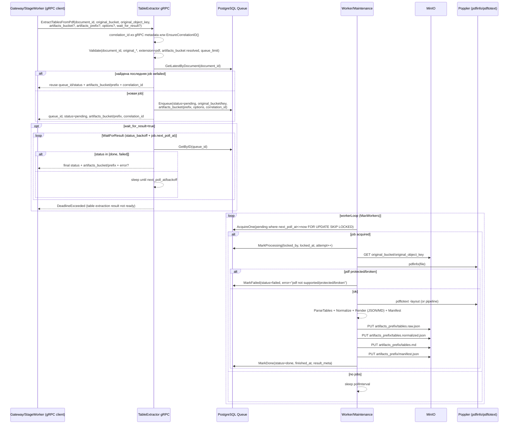
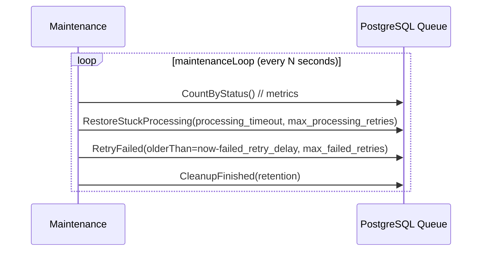
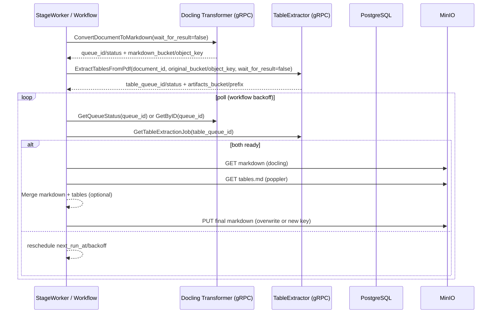

# Table Extractor Service — Sequence diagrams

Диаграммы отражают асинхронную постановку задачи через gRPC и обработку через очередь в PostgreSQL воркерами с использованием poppler и сохранением результатов в MinIO.

---

## 1) ExtractTablesFromPdf → enqueue → worker → MinIO → GetJob

Maintenance loop

Интеграция с пайплайном (Docling → TableExtractor → Merge)
