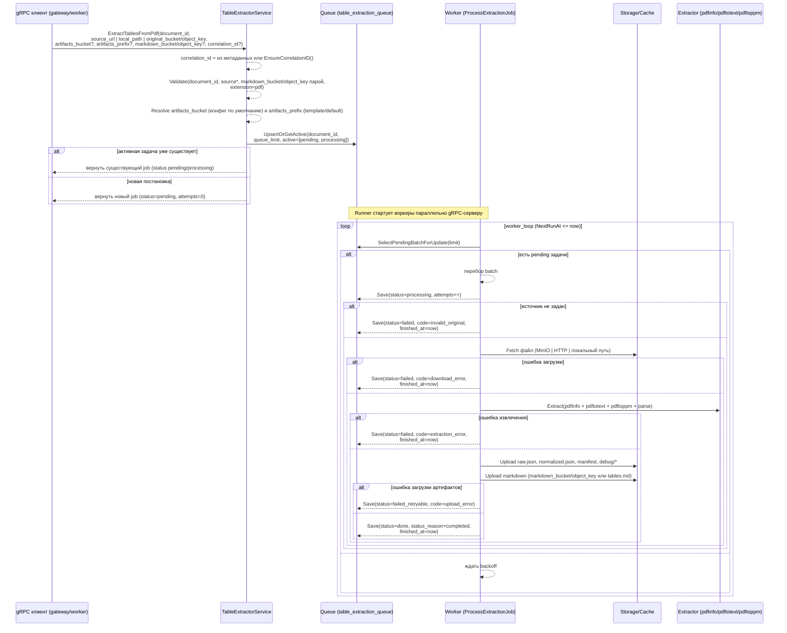
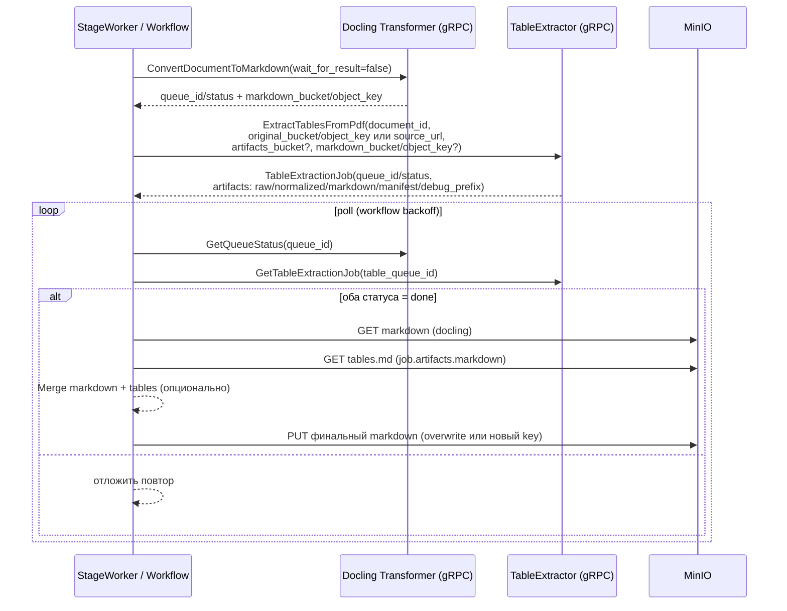

# Table Extractor Service — Sequence diagrams

Диаграммы отражают фактическое поведение gRPC-обработчиков, очереди в PostgreSQL и воркеров Table Extractor Service. Очередь хранится в таблице `table_extraction_queue`, обработка выполняется асинхронно воркерами, которые запускаются вместе с gRPC-сервером.

---

## 1) ExtractTablesFromPdf — постановка задачи и обработка



---

## 2) Maintenance — восстановление, ретраи и очистка

```mermaid
sequenceDiagram
    participant MT as Maintenance loop
    participant PG as PostgreSQL Queue

    Note over MT: Отдельная горутина Runner; при старте вызывается RestoreStuckProcessing

    loop maintenance_interval
        MT->>PG: ListProcessingBefore(now - processing_timeout)
        alt attempts >= max_attempts
            MT->>PG: Save(status=failed, error_code=processing_timeout,<br/>finished_at=now)
        else требуется повтор
            MT->>PG: Save(status=pending, status_reason=restored_after_timeout,<br/>next_run_at=now+backoff(attempts))
        end

        MT->>PG: RetryFailed(status in [failed, failed_retryable],<br/>attempts < max_attempts?)
        MT-->>PG: Save(status=pending, next_run_at=now+retry_delay)

        MT->>PG: Cleanup(status in [done, failed],<br/>finished_at <= now-retention)
    end
```

---

## 3) Polling статуса — клиент GetTableExtractionJob

```mermaid
sequenceDiagram
    participant CL as Client (gateway/document-service)
    participant TE as TableExtractor gRPC
    participant PG as PostgreSQL Queue

    loop пока нужен статус
        CL->>TE: GetTableExtractionJob(queue_id, correlation_id?)
        TE-->>TE: EnsureCorrelationID() + SetHeader(correlation_id)
        TE->>PG: GetByID(queue_id)
        alt найден
            TE-->>CL: job(status, status_reason, artifacts, correlation_id)
            alt status in [pending, processing, failed_retryable]
                CL-->>CL: ждать/backoff и повторить
            else status in [done, failed]
                CL-->>CL: загрузить артефакты из MinIO
            end
        else
            TE-->>CL: NotFound
            break
        end
    end
```

---

## 4) Интеграция с пайплайном (Docling → TableExtractor → Merge)


