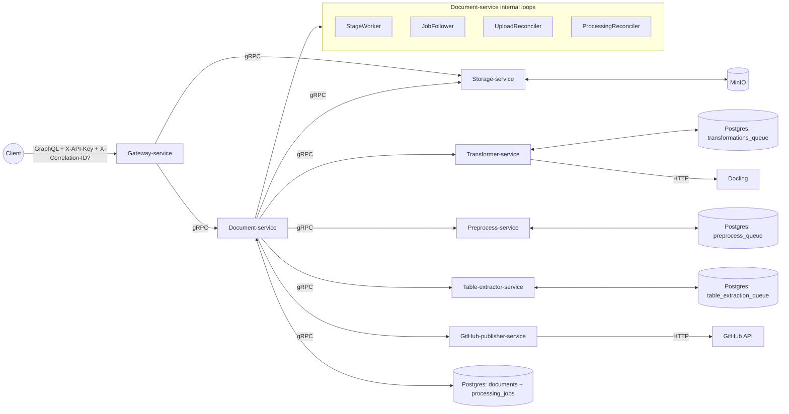
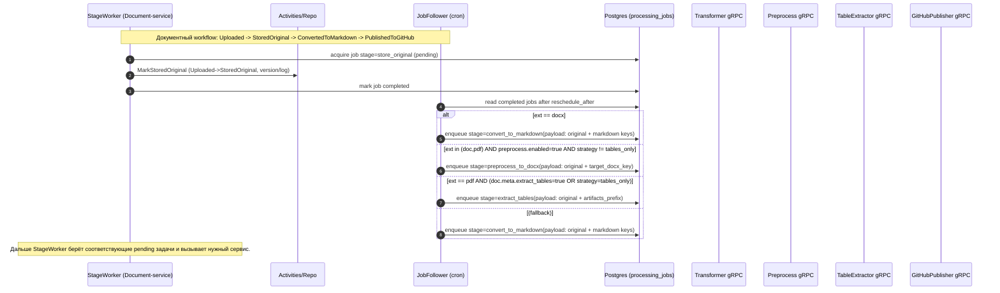
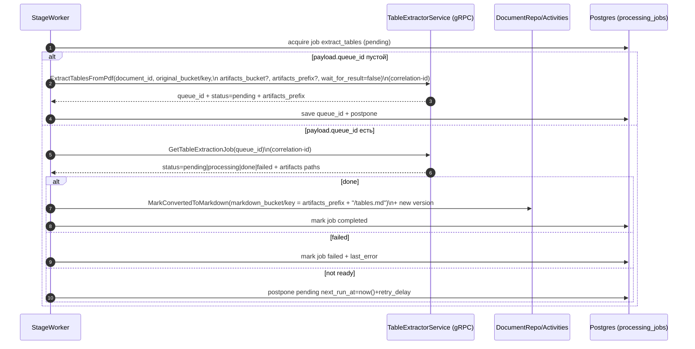
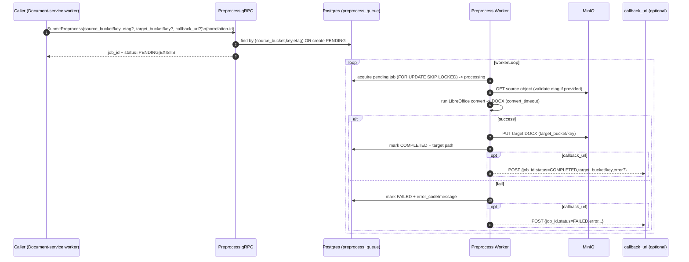
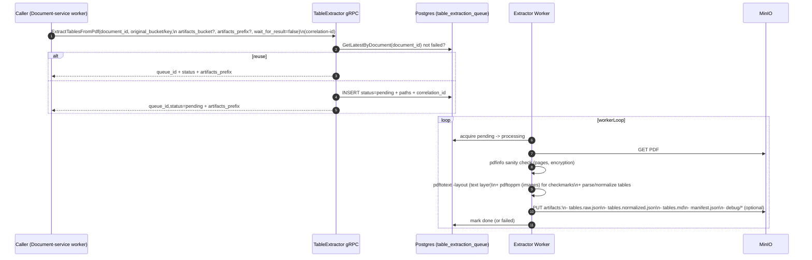
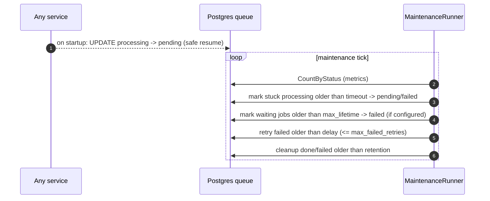

# sequence.md — диаграммы последовательностей (end‑to‑end + внутренние очереди)

> Нотация: `x-correlation-id` прокидывается **во все** gRPC/HTTP/MinIO операции и возвращается в ответы.  
> Все очереди — PostgreSQL (`..._queue`/`processing_jobs`) + воркеры с `FOR UPDATE SKIP LOCKED` и maintenance‑циклом.

---

## 0) Контекст: компоненты и связи (high level)



---

## 1) Upload → CreateDocument → ConfirmUpload (webhook из MinIO)

```mermaid
sequenceDiagram
    autonumber
    participant CL as Client
    participant GW as Gateway (GraphQL)
    participant ST as StorageService (gRPC)
    participant DS as DocumentService (gRPC)
    participant MN as MinIO
    participant WH as Gateway webhook /internal/storage/uploaded

    CL->>GW: uploadKnowledgeDocument(fileName,fileSizeBytes,repo,branch,path?)\nX-API-Key, X-Correlation-ID?
    GW-->>GW: EnsureCorrelationID (если нет)
    GW->>ST: GenerateUploadURL(documentId,fileName,size,ttl,correlation-id)
    ST-->>GW: uploadUrl + bucket/objectKey + markdownBucket/objectKey

    GW->>DS: CreateDocument(id=documentId, fileName, repo, branch, path(default if empty),\n upload bucket/key, markdown bucket/key,\n correlation-id)
    DS-->>GW: Document{status=UPLOADED, jobId?}

    GW-->>CL: uploadUrl + document + X-Correlation-ID

    CL-->>MN: PUT file to uploadUrl (x-amz-meta-correlation-id set by presign if present)
    MN-->>WH: POST ObjectCreated notification (records[])
    loop each record
        WH-->>WH: decode objectKey; extract document_id; correlation-id from metadata or new
        WH->>DS: ConfirmUpload(document_id,bucket,objectKey,correlation-id)
        DS-->>WH: OK (store_original job scheduled OR error)
    end
    WH-->>MN: HTTP 202 if any record processed else 400
```

---

## 2) Обработка `processing_jobs`: ветвление по типу файла (DOC/DOCX/PDF)

### 2.1 Решение маршрута (router) после `store_original`



### 2.2 Стадия `preprocess_to_docx` (polling + сохранение результата)

```mermaid
sequenceDiagram
    autonumber
    participant SW as StageWorker
    participant PP as PreprocessService (gRPC)
    participant S as Postgres (processing_jobs)
    participant MN as MinIO (artifacts)

    SW->>S: acquire job preprocess_to_docx (pending)
    alt job.payload.preprocess_job_id пустой
        SW->>PP: SubmitPreprocess(source_bucket,key,etag?, target_key?, callback_url?)\n(correlation-id)
        PP-->>SW: job_id + status=PENDING/EXISTS
        SW->>S: save preprocess_job_id + status=in_progress->pending (postpone)
    else уже есть preprocess_job_id
        SW->>PP: GetPreprocessStatus(job_id)\n(correlation-id)
        PP-->>SW: status=PENDING|PROCESSING|COMPLETED|FAILED + target_bucket/key
        alt COMPLETED
            SW->>S: mark job completed; payload.preprocessed_bucket/key saved
        else FAILED
            SW->>S: mark job failed; payload.last_error
        else not ready
            SW->>S: postpone pending next_run_at=now()+retry_delay
        end
    end

    Note over SW: Результат (docx) лежит в MinIO и используется в convert_to_markdown.
```

### 2.3 Стадия `convert_to_markdown` (через Transformer → Docling)

```mermaid
sequenceDiagram
    autonumber
    participant SW as StageWorker (Document-service)
    participant TR as TransformerService (gRPC)
    participant S as Postgres (processing_jobs)
    participant DS as DocumentRepo/Activities

    SW->>S: acquire job convert_to_markdown (pending)
    SW-->>SW: resolve source:\n- if payload.preprocessed_bucket/key exists -> use as original\n- else use document original bucket/key
    SW->>TR: ConvertDocumentToMarkdown(document_id, original_bucket/key,\n markdown_bucket/key, wait_for_result=false,\n source_bucket/key? | source_url?)\n(correlation-id)
    TR-->>SW: queue_id + status=pending|processing|waiting_docling|done|failed + resolved markdown path

    alt status == done
        SW->>DS: MarkConvertedToMarkdown(markdown_bucket/key, queue_id) + new version
        SW->>S: mark job completed
    else status == failed
        SW->>S: mark job failed + last_error
    else not ready
        SW->>S: postpone pending next_run_at=now()+retry_delay; payload.queue_id/status saved
    end
```

### 2.4 Стадия `extract_tables` (PDF → artifacts + tables.md → ConvertedToMarkdown)



### 2.5 Публикация в GitHub (без изменений)

```mermaid
sequenceDiagram
    autonumber
    participant SW as StageWorker
    participant GP as GitHubPublisherService (gRPC)
    participant DS as DocumentRepo/Activities
    participant S as Postgres (processing_jobs)

    SW->>S: acquire job publish_to_github (pending)
    SW-->>SW: resolve repo/branch/path + author + commit/pr templates\nidempotency_key = publish:<documentId>:<branch>:<markdown_key>
    SW->>GP: PublishMarkdown(path, bucket+object_key OR content,\n create_pr?, branch, base_branch,\n commit_message, author_*, idempotency_key)\n(correlation-id)
    GP-->>SW: SUCCESS | TEMPORARY_FAILURE(retry_after) | PERMANENT_FAILURE + commit_sha + PR?

    alt SUCCESS
        SW->>DS: MarkPublished(commit_sha, PR info) + new status log
        SW->>S: mark job completed
    else TEMPORARY_FAILURE or transient gRPC errors
        SW->>S: postpone pending next_run_at=now()+backoff; attempts++
    else PERMANENT_FAILURE
        SW->>S: mark job failed + last_error
    end
```

---

## 3) Внутри Transformer-service: очередь → Docling submit → poll → result

```mermaid
sequenceDiagram
    autonumber
    participant TR as Transformer gRPC
    participant PG as Postgres (transformations_queue)
    participant WK as Transformer Worker
    participant DL as Docling HTTP
    participant MN as MinIO

    TR->>PG: GetLatestByDocument(document_id)
    alt found last job status != failed
        TR-->>TR: reuse existing job (idempotent)
        TR-->>TR: return queue_id/status + resolved output path
    else enqueue new
        TR->>PG: INSERT status=pending, paths, ext, correlation_id
        TR-->>TR: return queue_id,status=pending + output path
    end

    loop workerLoop
        WK->>PG: AcquireBatch(waiting_docling due first; if any waiting_docling exists => block pending)
        alt no docling ids yet
            WK->>DL: POST /v1/convert/file/async OR /v1/convert/source/async (with X-Correlation-Id)
            alt submit ok
                WK->>PG: set waiting_docling + docling_task_id/job_id + next_poll_at
            else submit temp fail after retries
                WK->>PG: keep waiting_docling w/o ids + next_poll_at(backoff)
            end
        else has ids
            WK->>DL: GET /v1/status/poll/{id}
            alt ready
                WK->>DL: GET /v1/result/{id}
                WK->>MN: PUT markdown to markdown_bucket/key
                WK->>PG: mark done
            else transient error or too many attempts
                WK->>PG: requeue pending + reset ids + retry_count++ (or fail if limits)
            else still running
                WK->>PG: keep waiting_docling + next_poll_at(backoff)
            end
        end
    end
```

---

## 4) Внутри Preprocess-service: очередь → LibreOffice → MinIO (+ callback)



---

## 5) Внутри Table-extractor-service: очередь → Poppler → artifacts bundle → MinIO



---

## 6) Рестарты и восстановление (общий паттерн очередей)


